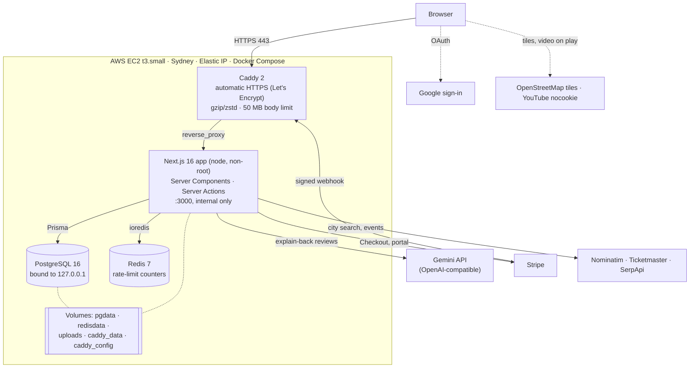
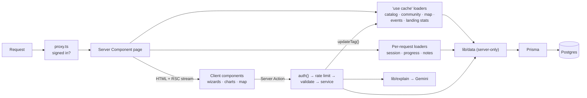
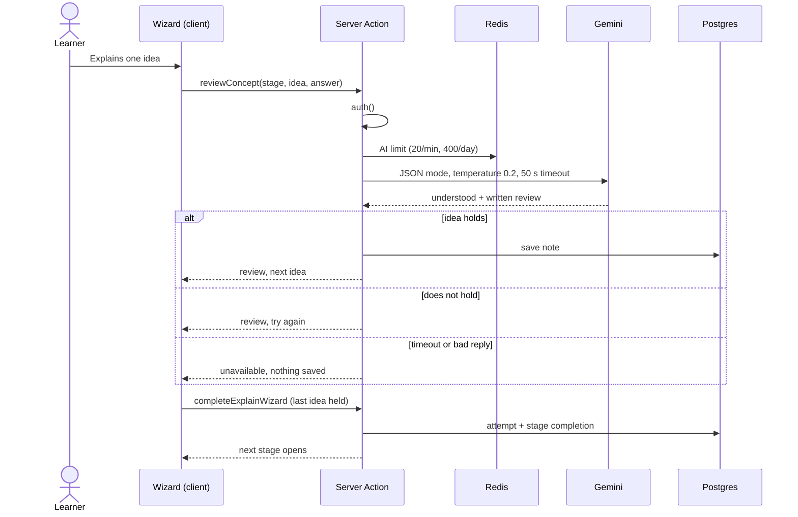

# SkillFlow

**A mastery-first learning platform.** SkillFlow only counts a stage as learned when you can explain each idea back in your own words and an AI reviewer agrees. There is no quiz, no leaderboard, and no watch-time score.

**Live:** https://app.32-236-251-56.sslip.io (temporary domain while the brand name is decided)

| Doc | What it is for |
| --- | --- |
| `README.md` | This file: what SkillFlow is, how it is built, how to run and deploy it |
| `STUDY-GUIDE.md` | Every concept and feature end to end, for revision and interviews |
| `HANDOFF.md` | Self-contained brief for testing and operating the deployment |
| `Project-roadmap.md` | The build record and phase list |
| `AGENTS.md` | Working context and rules for coding assistants |
| `UI-AUDIT.md` | The October 2026 design and accessibility audit |

---

## What it does

1. **Follow a path.** Thirty free paths (Full-Stack Web Development, Travel Vlogging, Content Creation, Music Production, Cybersecurity, Personal Finance, and 24 more) with 246 stages and about 900 curated free resources: YouTube videos played in-app, docs, and courses.
2. **Learn a stage.** A step-by-step lesson wizard walks through the clip and each resource.
3. **Explain it back.** One idea per step. Gemini writes a review of every answer. The step moves on only when the idea holds. If the model is unavailable, nothing is saved: the app never fakes a pass.
4. **Keep what you learned.** Accepted ideas become notes (exportable as Word or PDF), come back twice for spaced recall 18 hours apart, and feed mastery, streaks, weak topics, and analytics.
5. **Finish the path.** Each pass opens the next stage. Passing every stage earns a certificate and a transcript.

Around that loop: personal learning plans built in code from your preferences, a 180-item career-fit test, a moderated Open Source community per niche, a creator studio, an opt-in learner map (city counts only), nearby events, notifications, a full analytics page, self-serve account deletion, and a two-minute interactive tour on Home with a small hands-on demo for each feature. **Premium** is one Stripe subscription that opens the niches outside the thirty free paths and appearing on the learner map; everything above stays free.

What SkillFlow refuses on purpose: quizzes, comments, likes, view counts, trending, leaderboards, peer review, and guilt copy when a streak breaks.

---

## Architecture

### Production system



### Inside the app



### The explain-back loop



`STUDY-GUIDE.md` §6 has more diagrams (deploy pipeline, data model).

---

## Tech stack

| Layer | Choice |
| --- | --- |
| Framework | Next.js 16.3.4 (App Router, Cache Components, `proxy.ts`, `instrumentation.ts`), React 19.2.8, TypeScript |
| Styling | Tailwind CSS v4 with design tokens in `app/globals.css`; dark/light themes; accent presets, Spectrum, custom gradients |
| Data | PostgreSQL 16 through Prisma 6.19.3; 27 hand-written, additive migrations |
| Auth | Auth.js v5 (JWT sessions), email + bcrypt password, Google OAuth (verified email only, no auto-linking) |
| AI | Gemini free tier (`gemini-flash-lite-latest`) through the OpenAI-compatible endpoint; OpenAI or any compatible endpoint as fallbacks |
| Rate limits | Redis 7 (`ioredis`), fixed-window counters |
| Payments | Stripe Checkout, customer portal, signed webhooks |
| Maps | MapLibre GL + supercluster, OpenStreetMap tiles and Nominatim |
| Other | framer-motion, Recharts, `docx` and `pdf-lib` exports, Zod, `next/og` images |
| Tests | Vitest (183 tests in 38 files), Playwright (8 end-to-end tests) |
| Deploy | Docker (multi-stage, non-root, health check), Docker Compose, Caddy, AWS EC2 |

**Caching.** Content that is the same for everyone is cached with `"use cache"` and tags (`catalog`, `community`, `learner-map`, `geocode`, `nearby-events`, `practice-source`, `landing-stats`, `account:<id>`), and writes expire them with `updateTag`. Progress, streaks, notes, follow state, and the account menu are read per request. Redis is not a cache; it only holds rate-limit counters.

---

## Run it locally

```bash
npm install
cp .env.example .env            # fill in DATABASE_URL, AUTH_SECRET (npx auth secret), GEMINI_API_KEY …
docker compose up -d            # Postgres 16 on 5432 and Redis 7 on 6379
npx prisma migrate deploy
npx prisma db seed              # only on a new, empty database
npm run dev                     # http://localhost:3000
```

- The server validates every environment variable at start (`lib/env.ts`) and refuses to run with a missing or malformed value, naming the variable but never printing its value.
- The seed creates admins only from `SEED_ADMIN_EMAILS` and `SEED_ADMIN_PASSWORD` (12+ characters), never resets an existing password, rewrites every niche, and refuses production unless `ALLOW_PROD_SEED=yes`. **Never run it on a database that has people in it.**
- Apply migrations with `prisma migrate deploy`. Never `migrate dev` or `migrate reset` on a database that matters.
- Without `REDIS_URL` the rate limits are off, which is fine locally. Production requires `REDIS_URL`, `CRON_SECRET`, and `GEOCODER_USER_AGENT`.

### Tests

```bash
npm test                          # Vitest unit tests
npx tsc --noEmit                  # type check
npm run build                     # production build (needs the database: catalog pages prerender)
npx playwright install chromium   # once
npm run test:e2e                  # Playwright; needs a seeded database, adds one e2e learner per run
```

---

## Production

SkillFlow runs on one AWS EC2 instance (`t3.small`, Ubuntu, Sydney, Elastic IP) with four Compose services from `docker-compose.prod.yml`:

| Service | Image | Notes |
| --- | --- | --- |
| `app` | built from `Dockerfile` | Node 22 slim, three stages, runs as `node`, `HEALTHCHECK` on `/api/health`, uploads on a volume |
| `postgres` | `postgres:16` | Data in the `pgdata` volume; port bound to `127.0.0.1` only |
| `redis` | `redis:7-alpine` | Append-only persistence; not published |
| `caddy` | `caddy:2` | The only public service (80, 443); automatic Let's Encrypt certificates for `DOMAIN` |

The build prerenders the catalog, so it needs Postgres: the database URL reaches the build through a BuildKit secret (`.env.build`, mounted only during that step and never stored in the image) with host networking. Runtime settings come from `.env` on the server (`chmod 600`, never committed).

**Redeploy** (after pushing to `main`):

```bash
cd ~/skillflow
docker compose exec -T postgres pg_dump -U skillflow -Fc skillflow > ~/backup-$(date +%F-%H%M).dump
git pull
docker compose build app
docker compose run --rm app node_modules/.bin/prisma migrate deploy
docker compose up -d
docker compose ps                 # app should be (healthy)
docker builder prune -af          # reclaim build cache; never prune volumes
```

`GET /api/health` returns 200 with `{ status, db, latencyMs, uptimeSeconds, commit }` when Postgres answers and 503 when it does not. `HANDOFF.md` has the full operations brief, every environment variable, and the remaining checklist.

---

## Security and limits

- **Rate limits** (`lib/limits.ts`, Redis): log-in 5 per email and 30 per IP every 15 minutes (fails closed; a blocked try looks like a wrong password), sign-up 5 per IP an hour, AI calls **20 a minute and 400 a day** per learner, uploads 20 an hour per learner.
- **AI calls** time out after 50 seconds (Gemini's free tier sometimes queues requests); a timeout saves nothing.
- **Headers** on every response: `X-Frame-Options: DENY`, `nosniff`, `Referrer-Policy`, a restrictive `Permissions-Policy`, HSTS in production, no `X-Powered-By`. The Content Security Policy is report-only until a clean pass.
- **Server-side fetches** of learner-supplied URLs go through an SSRF guard (private, loopback, link-local, metadata, and IPv4-mapped addresses are blocked).
- **Uploads** are checked by extension, size, and magic bytes, stored under random names, and served by `app/uploads/[file]/route.ts` with byte ranges.
- **Stripe webhooks** are verified against the raw body before any write.

---

## Service keys

Copy names from `.env.example`. Leave a key blank to turn that feature off.

- **Explain-back model.** `GEMINI_API_KEY` (free, [aistudio.google.com/apikey](https://aistudio.google.com/apikey)); optional `GEMINI_MODEL`. `OPENAI_API_KEY` is used only when the Gemini key is empty. `EXPLAIN_MODEL_KEY`, `EXPLAIN_MODEL_URL`, `EXPLAIN_MODEL_NAME` point at any OpenAI-compatible endpoint and win when set. With no key, no stage can be passed.
- **Google sign-in.** `AUTH_GOOGLE_ID` and `AUTH_GOOGLE_SECRET` (both or neither). In Google Cloud Console create a Web OAuth client with the origin and the redirect URI `https://<domain>/api/auth/callback/google` (and `http://localhost:3000/...` for development). Login and signup are static pages, so the keys must be present **at build time** for the buttons to render. While the consent screen is in Testing, only listed test users can sign in.
- **Stripe.** `STRIPE_SECRET_KEY`, `NEXT_PUBLIC_STRIPE_PUBLISHABLE_KEY`, `STRIPE_PRICE_ID`, `STRIPE_WEBHOOK_SECRET` (all four or none), optional `STRIPE_PRICE_LABEL`. Register `https://<domain>/api/stripe/webhook` for `checkout.session.completed` and `customer.subscription.*`. Without keys, `/upgrade` says Stripe is not configured.
- **Map and events.** `GEOCODER_USER_AGENT` (a real contact, required in production), `MAP_MIN_LEARNERS` (default 5), `TICKETMASTER_API_KEY` (capped at 5,000 calls a day), `SERPAPI_API_KEY` (capped at 200 searches a month), `EVENTS_TTL_HOURS` (12), `EVENTS_CRON_PAIRS` (20), `CRON_SECRET` (32+ characters; `GET /api/cron/events` with `Authorization: Bearer <secret>`).

---

## Catalog

Researched paths live in `content/catalog/*.json`. The importer is server-only, dry-runs by default, and writes one skill in one transaction.

```bash
npx tsx scripts/verify-catalog.ts <slug>                                  # link check
npx tsx --conditions=react-server scripts/import-catalog.ts <slug>        # dry run
npx tsx --conditions=react-server scripts/import-catalog.ts <slug> --apply
npx tsx scripts/verify-catalog.ts <slug> --from-db                        # mark dead stored links UNAVAILABLE
```

The Full-Stack slug is `full-stack-web-dev` and its file is `full-stack-web-development.json`; Animation's slug is `animation`. The importer never changes a skill's status, offer, cover, flagship flag, or stage photos. Admins can also edit everything in the Catalog CMS (account menu → Admin CMS → `/admin/catalog`); deletes that would erase learner records are refused.

---

## Open Source roles

Admins review, moderate, and grant roles everywhere. A maintainer reviews and moderates one niche and grants reviewers there. A reviewer reviews one niche. Nobody reviews their own contribution or changes their own role. Grant roles at `/admin/community`. Reviews use compare-and-set on status and revision, so two reviewers cannot both decide the same post.

---

## UI

The October 2026 polish is in `UI-AUDIT.md` (screenshots in `docs/ui-audit/`). Lighthouse 12 against `next start` (7 October 2026):

| Page | Performance (mobile / desktop) | Accessibility | Best practices |
| --- | --- | --- | --- |
| Landing | 69–75 / 99 | 100 | 100 |
| Home | 87 / 100 | 100 | 100 |
| A path | 89 / 100 | 100 | 100 |
| A lesson | 78 / 100 | 100 | 100 |

Signed-in pages score 63 on SEO because they send `noindex` on purpose.

---

## Status and what is ahead

**Done:** the product (frozen as of 15 October 2026), the deploy groundwork, Docker, and the production deployment on AWS with HTTPS.

**Still ahead:**
- Daily database backups to S3, CI/CD with GitHub Actions, uptime and error monitoring.
- Google sign-in and a Stripe test charge in production, rotated event API keys, the cron schedule for events.
- The final brand and domain, then enforcing the CSP.
- Integration tests and an end-to-end pass through explain-back with the model stubbed.
- Catalogs for Premium niches (they have no stages yet).

