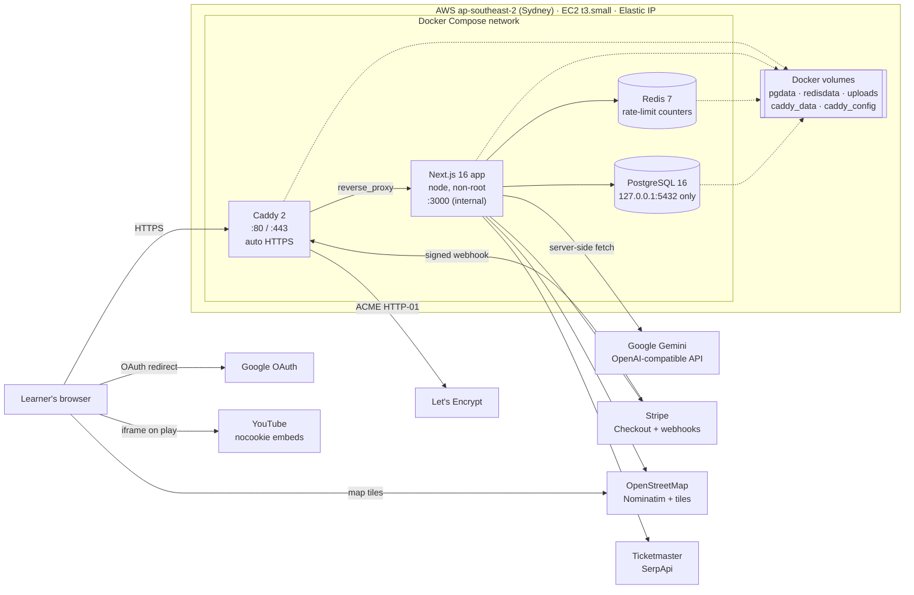
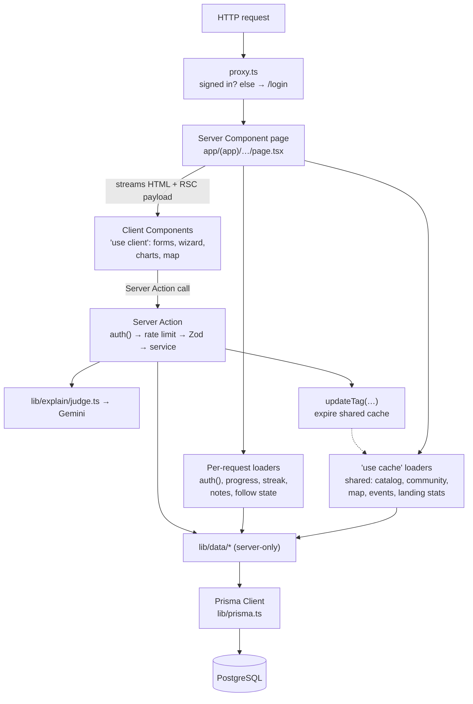
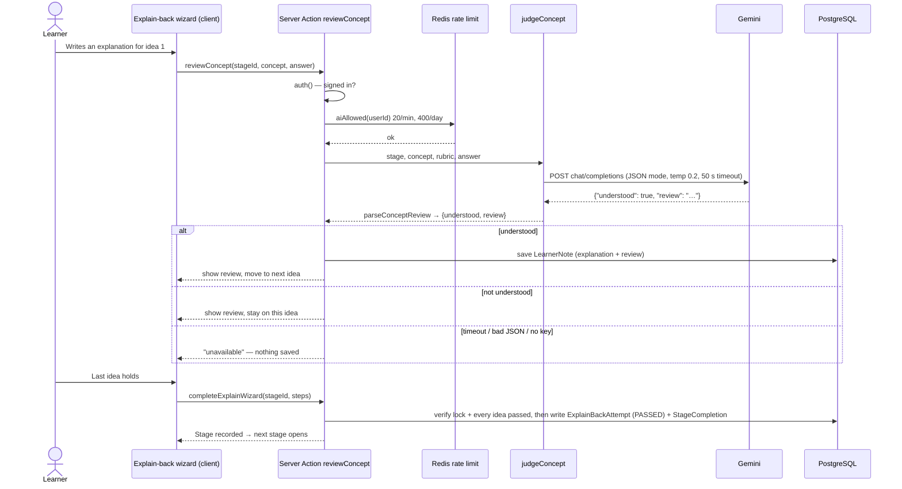
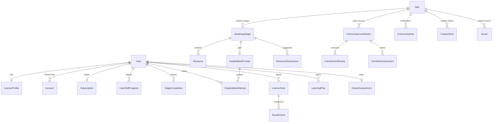

# SkillFlow — The Complete Study Guide

> Everything about SkillFlow in one place, from the product idea down to the Linux commands that keep it running, written so the founder can revise, explain, and defend every part of it.
>
> This file is for learning. It is not a to-do list. `Project-roadmap.md` is the build record, `HANDOFF.md` is the deploy brief, `AGENTS.md` is the context for coding assistants, and `README.md` is the front door.
>
> Last aligned with the code on **16 October 2026**, the day the feature list closed. The product is feature-complete: what follows describes the finished feature set.

---

## How to use this guide

- **Before an interview:** read Part A (the product), the diagrams in Part B §6, all of Part D, and the incident log (§29). That is roughly an hour.
- **To learn a concept properly:** each section explains what the thing is, why it is a problem worth solving, how SkillFlow solves it, and where the code lives. File paths are written like `lib/explain/judge.ts`.
- **Each section ends with "Say it in one line".** Those lines are your interview answers. Learn them by heart.
- **The honest-claims rule:** never say SkillFlow does something it does not do. §36 lists what you can and cannot claim.

### Contents

**Part A — The product**
1. The pitch at three lengths
2. The problem and the philosophy
3. The core loop, end to end
4. Product vocabulary
5. Every feature, one by one

**Part B — Architecture and code**
6. Architecture diagrams
7. The folder map
8. Next.js 16 concepts used
9. React 19 and client-side concepts
10. TypeScript, Zod, and the result-type pattern
11. The database: PostgreSQL and Prisma
12. Authentication in depth
13. The AI integration in depth
14. The caching strategy in depth
15. Rate limiting and Redis
16. Security, mapped to OWASP
17. External integrations
18. File uploads
19. Algorithms and the pure-logic modules
20. The UI system and accessibility
21. Testing

**Part C — Production and DevOps**
22. Docker from first principles
23. The production Compose file, line by line
24. Caddy, HTTPS, and the domain
25. AWS: everything we set up and why
26. Linux server operations
27. The first deploy, step by step
28. The redeploy runbook
29. Incident log: every bug, its cause, and the lesson
30. What is not done yet, and how it would be done

**Part D — Interview preparation**
31. System design: scaling SkillFlow
32. Trade-off decisions
33. The question bank (with answers)
34. Numbers to remember
35. Technical glossary
36. Honest claims

**Part E — The SkillFlow Assistant**
37. The SkillFlow Assistant (RAG), end to end, with interview questions

---

# PART A — THE PRODUCT

## 1. The pitch at three lengths

**One sentence.** SkillFlow is a learning platform that only counts a lesson as learned when you can explain it back in your own words, and an AI reviewer agrees.

**Thirty seconds.** Most learning apps measure watch time, streaks, and completion ticks, which reward clicking "next" rather than understanding. SkillFlow curates real free resources (YouTube videos, docs, courses) into ordered paths of stages. After each stage, the learner explains every key idea back in their own words. An AI reviewer (Gemini) writes a review for each idea, and the next stage only opens when every idea holds. Accepted ideas become the learner's personal notes, which come back later for spaced recall. Thirty paths are completely free; Premium is one Stripe subscription.

**Two minutes (for "tell me about your project").**
1. *Problem.* Online learners confuse exposure with understanding. Apps reinforce it with streaks, view counts, and quizzes that can be guessed.
2. *Product.* Thirty free paths (Full-Stack Web Development, Travel Vlogging, Content Creation, Music Production, and 26 more) with about 900 curated resources across 246 stages. Each stage ends with an **explain-back gate**: one idea at a time, a written AI review on every attempt, and no pass until each idea holds. Around that sit notes, spaced recall, mastery and streaks, transcripts and certificates, personal learning plans, a career-fit test, a moderated Open Source community, a creator studio, a learner map, and nearby events.
3. *Engineering.* Next.js 16 with React Server Components and Cache Components, PostgreSQL through Prisma, Auth.js with JWT sessions and Google sign-in, Gemini through its OpenAI-compatible API, Redis rate limits, Stripe Checkout with signed webhooks, Vitest and Playwright tests.
4. *Production.* It runs in Docker Compose on an AWS EC2 instance (app, Postgres, Redis, and Caddy for automatic HTTPS), deployed for $0 on the AWS free plan, with environment validation at startup, a health check, security headers, and rate limits.
5. *What I learned.* Designing for honesty (the app never fakes a pass when the AI is down), caching shared content while keeping personal data per request, and debugging production problems end to end (an AI timeout that only showed up on the free tier, a full disk, a build that needed the database).

> **Say it in one line:** "SkillFlow checks understanding instead of watch time: you explain each idea back, an AI reviews it, and only then does the next stage open."

---

## 2. The problem and the philosophy

### The problem
- **Exposure is not understanding.** Watching a 20-minute video feels like learning. Recall research (the "testing effect", "generation effect", and the Feynman technique) shows that producing an explanation is what builds understanding.
- **Engagement metrics distort learning products.** Likes, view counts, leaderboards, and guilt streaks optimise for time-in-app.
- **Quizzes are weak checks.** Multiple choice can be guessed and rewards recognition over recall.
- **Good free content exists but is scattered.** The problem is choosing, ordering, and verifying, not producing more content.

### The philosophy (what SkillFlow refuses)
| Refused | Why |
| --- | --- |
| Quizzes | Dropped on 1 October 2026. Recognition is not understanding; the explain-back is the only check |
| Comments, likes, view counts, trending | They reward attention, not learning. Open Source allows one question per learner and one answer from the author |
| Leaderboards, peer review | Comparison and social grading add pressure without verifying understanding |
| Guilt copy when a streak breaks | A streak is information, not a punishment |
| Faking a pass | If the AI key is missing, the model times out, or the reply is not a review, **nothing is saved**. The stage stays open. Honesty beats convenience |
| Paywalling the core loop | Thirty full paths, explain-back, notes, recall, certificates, the map, and events are free. Premium only adds the extra niches and appearing on the map |

> **Say it in one line:** "The product's rule is that progress must be verified understanding, not time spent, so I removed every feature that rewards attention instead."

---

## 3. The core loop, end to end

```
Sign up → Onboarding (pick up to 5 free paths) → Home
   → open a Path → open a Stage (lesson wizard: clip, then each resource)
   → "Explain it back" → wizard, one idea per step
        → write your explanation → AI writes a review
        → idea holds? → saved as a Note → next idea
        → idea does not hold? → stay on the step, try again
   → every idea held → stage recorded (ExplainBackAttempt + StageCompletion)
   → next stage opens → mastery % rises → streak day counts
   → 18 h later: a recall card asks for that idea again (twice in total)
   → all stages passed → certificate
```

What happens in the system at each step:
1. **Sign up** writes `User` (bcrypt hash). Rate limit: 5 sign-ups per IP per hour. The landing totals cache is dropped so the learner count updates.
2. **Onboarding** writes `LearnerProfile` and one `UserSkillProgress` row per chosen path ("following").
3. **Home** (`/dashboard`) reads per-request data: streak, mastery, weak topics, lanes, For you.
4. **Path page** (`/roadmap/[slug]`) reads the *cached* catalog and overlays this learner's progress on the request.
5. **Lesson** (`/lesson/[stageId]`) is cached shared content plus a personal lock check.
6. **Explain-back** (`/milestone/[stageId]`): the first open generates the stage's ideas from its resources (cached into the database), then each step calls a Server Action → rate limit → Gemini → parse → save a `LearnerNote` if the idea held.
7. **Completion** writes one `ExplainBackAttempt` (verdict `PASSED`) and sets `StageCompletion.explainBackPassed`. The next stage's lock is computed from these rows.
8. **Recall** reads notes whose pass is at least 18 hours old, shows a card that blocks the app until any answer, and scores it strong (100), partial (55), or weak (20).

> **Say it in one line:** "Learn, explain back one idea at a time, get a written AI review, and only verified ideas become notes and unlock the next stage."

---

## 4. Product vocabulary

| Term | Meaning |
| --- | --- |
| **Niche** | A subject area (`Skill` row). About 175 exist; 30 are free paths with content, the rest are Premium with no stages yet |
| **Path** (route `/roadmap`) | A niche's ordered list of stages. UI copy says "Path" |
| **Stage** | One step on a path (`RoadmapStage`): title, description, photo, learning objectives, resources |
| **Resource** | One external item on a stage: `HOOK_CLIP`, `EMBEDDED_VIDEO`, `DOC_LINK`, or `COURSE_LINK`. Stores a snapshot (title, description, key points, transcript) so a dead link still teaches |
| **Idea / concept / learning objective** | One thing the learner must explain. Stored as `RoadmapStage.learningObjectives` |
| **Explain-back** | The gate at the end of a stage. One idea per step, AI review each time |
| **Rubric** | One line per idea saying what a good explanation includes (`ExplainBackPrompt.rubric`) |
| **Note** | An accepted idea: the learner's explanation plus the AI review (`LearnerNote`) |
| **Practice note** | A note graded against a page, file, or pasted passage the learner brings. Never passes a stage |
| **Recall** | The same idea asked again 18 hours after passing, twice in total (`RecallCheck`) |
| **Retention** | The average of recall scores (0–100) |
| **Mastery** | Passed open stages ÷ open stages, as a percent, per path |
| **Streak** | Consecutive UTC days with a saved explain-back or a saved note |
| **Follow** | A `UserSkillProgress` row: the path appears on Home |
| **Free path / Premium niche** | Free = in `FREE_PATH_SLUGS`, `offer FREE`. Premium = `offer MONETIZED`, needs an active or trialing subscription |
| **Flagship** | Four highlighted paths: Full-Stack, Travel Vlogging, Content Creation, Art & Painting |
| **Contribution** | An Open Source post. Stored status `MERGED` means published |
| **Admin / Maintainer / Reviewer** | `ADMIN` is a user role. Maintainer and Reviewer are per-niche community roles |

---

## 5. Every feature, one by one

Each feature lists **what** it does, **why** it exists, **how** it works (data and code), and the **edge cases** worth mentioning.

### 5.1 Accounts and sign-in
- **What.** Sign up with name, email, and password; log in; log out; Google sign-in when keys are set; connect or disconnect Google from Settings.
- **Why.** A learning record must belong to someone. Google lowers sign-up friction.
- **How.**
  - `lib/auth.ts` configures Auth.js v5 with the Prisma adapter, `session: { strategy: "jwt" }`, `trustHost: true`, a Credentials provider, and Google when both keys exist (`googleAuthEnabled()`).
  - Credentials `authorize`: normalise the email (lowercase, trim) → `loginAllowed(email, ip)` rate limit (fails closed) → find the user → `bcrypt.compare` → return the user or `null`.
  - The `jwt` callback copies `id` and `role` into the token. The `session` callback copies them onto `session.user`.
  - Google: the `signIn` callback only accepts `profile.email_verified === true`. A Google sign-in whose email already belongs to a password account is refused with `OAuthAccountNotLinked` (Auth.js default). The learner logs in with the password first, then connects Google in Settings. The `linkAccount` event sets `emailVerified`, may move an unverified email to the verified Gmail, and fills `User.image` if empty.
  - `/auth/continue` decides where a Google sign-in lands: onboarding for a new learner, Home otherwise.
- **Edge cases.** A blocked log-in looks exactly like a wrong password, so an attacker learns nothing. A Google-only account has no password, so disconnecting Google is refused (it would lock the person out). The Google buttons render at **build time** because login and signup are static pages, so the keys must exist when the image is built.
- **Say it in one line:** "Auth.js with JWT sessions; passwords are bcrypt hashes behind a fail-closed rate limit, and Google is never linked by email match alone, because that would allow an account takeover."

### 5.2 Onboarding
- **What.** Eight steps: display name and photo, about you (age range, stage, headline), city, up to five free paths, goals and experience, time/formats/languages, accent, summary.
- **Why.** Personalises Home and plans, and enforces the age rule (under 13 refused; 13–17 needs a parent's consent, per the DPDP Act 2023).
- **How.** `components/onboarding/OnboardingWizard.jsx`; options and validation in `lib/onboarding-options.ts`; save writes `LearnerProfile` and a `UserSkillProgress` row per path (it never unfollows). The free-path picker uses the `catalog` cache. `/onboarding?edit=1` reopens it.
- **Display name rule.** 2–50 characters and never an email address (`displayNameProblem` in `lib/profile-identity.ts`), because names are public on profiles and Open Source.
- **Generated avatars.** `lib/avatar.ts` draws deterministic SVGs from a style and seed. The server redraws the avatar itself (it never trusts SVG sent by the client, since SVG can carry scripts) and stores a 256px PNG via `next/og` (`lib/avatar-render.tsx`).

### 5.3 Niches, free paths, and Premium
- **What.** `/skills` lists every niche: search, group filter, 32 cards a page. Free paths say "Free · N stages"; others say "Premium".
- **How.** `FREE_PATH_SLUGS` in `lib/niches/tiers.ts`. A stage is structurally open when the skill is `AVAILABLE`, the offer is `FREE`, and the stage is not monetized (`stageCountsAsOpen` in `lib/progress/formula.ts`). `LOCKED_TAIL = 0`, so every stage on a free path is open, and the certificate can be earned. The whole list is cached once; the browser pages through it locally, so the page number is not a cache key.
- **Edge case.** A free account clicking a Premium card goes to `/upgrade`; a subscriber or admin goes to the roadmap, which says the catalog is not ready (Premium niches have no stages yet, and the docs say so honestly).

### 5.4 Paths and the lock rule
- **What.** `/roadmap/[slug]`: cover hero, "Up next", stage cards with photo, state chip (passed, up next, locked), and a personal plan.
- **The two locks:**
  1. **Structural lock** (shared, cacheable): is this stage open on this path at all? (free + available + not monetized).
  2. **Personal lock** (per learner, never cached): every earlier open stage must have a passed explain-back. Message: "Pass the previous stage to open this one." It is checked in `loadCatalog`, `getLesson`, the milestone page, *and* the explain-back write, so a learner cannot skip by typing a URL or calling the action directly.
- **Say it in one line:** "The shared catalog is cached for everyone, and the personal unlock is computed on each request and enforced again on the server write."

### 5.5 Lessons and the lesson wizard
- **What.** `/lesson/[stageId]` is a step-by-step wizard: intro, "Watch first" (the clip), one slide per resource, then "When you are ready" → Explain it back.
- **How.**
  - `CachedLesson.tsx` (server, `use cache`) loads and orders the resources and renders each slide's content on the server. `LessonWizard.tsx` (client) only moves between slides.
  - YouTube links are rewritten by `lib/playable-src.ts` to `https://www.youtube-nocookie.com/embed/ID?autoplay=1`, loaded only when the learner presses play (privacy and performance).
  - Progress UI: "Step N of M", a percent bar, 24px step dots, one emoji encouragement line by progress, sticky Back/Next, ←/→ keys and swipe (except while typing, on a video, or under a dialog).
  - framer-motion `AnimatePresence` with direction-aware variants (exit 140 ms, enter 240 ms). Reduced motion makes changes instant, but only after hydration (`useCalmMotion`) so the server and first client render match.
  - The current step is stored in `localStorage` under `skillflow-lesson-step:<stageId>` and read with `useSyncExternalStore` (the server renders the intro).
  - Accessibility: the slide region is `aria-live="polite"` and focus moves to the new slide heading.
- **Edge case.** A locked lesson sends no resource text, only the stage and skill name, so the lock cannot be bypassed by reading the page source.

### 5.6 Clips
- Short-form resources (`HOOK_CLIP`) from open stages plus approved creator videos, in a feed with no comments or counts. Cached under `catalog`.

### 5.7 Explain-back (the heart of the product)
- **What.** `/milestone/[stageId]`, a focus-mode wizard. One learning objective per step. Every answer gets a written two-to-four-sentence review. The step moves on only when the idea holds. After the last idea, the stage is recorded.
- **Where the ideas come from (`lib/explain/gate-store.ts`, `ensureGateConcepts`).**
  1. Load the stage and its resources.
  2. Hash the sources (`gateSourceHash`). If the stored `conceptSourceHash` matches and objectives exist, stop: nothing changed.
  3. Otherwise read up to 6 doc/course pages (not YouTube, not `UNAVAILABLE`) through the SSRF-guarded reader; skip a blocked page.
  4. Ask the model to propose concepts and rubric lines (`proposeGateConcepts`), parse them (`parseGateConcepts`), and **merge in every stored key point** (`withEveryKeyPoint`), so the model can add but never drop curated ideas.
  5. In one transaction, update `learningObjectives` and upsert `ExplainBackPrompt` (question, rubric, hash, `version` + 1). Then expire the catalog cache.
  - Wrapped in React `cache()` so it runs once per request. With no model key, the catalog's existing questions stay.
- **Each step (`reviewConcept` Server Action).** `auth()` → `aiAllowed(userId)` (20/min, 400/day) → `reviewConceptStep` → `judgeConcept` sends the stage title, description, the one concept, rubric, and the answer to the model with JSON mode → `parseConceptReview` returns `{ understood, review }`. A missing or short review is replaced with a fixed sentence, so the learner never gets only a tick or a cross. If understood, a `LearnerNote` is saved.
- **Completion (`completeExplainWizard`).** `finishExplainWizard` re-checks that every idea passed and that the personal lock allows this stage, then writes one `ExplainBackAttempt` and sets `StageCompletion.explainBackPassed`. Misses are stored as `NEEDS_IMPROVEMENT` attempts with the idea in `followUpQuestion` (this feeds Weak topics).
- **The honesty rule.** No key, a timeout, a network error, or a reply that is not a review → `unavailable`, nothing saved, the step stays. The app never invents a grade.
- **Prompt design (`CONCEPT_SYSTEM` in `lib/explain/judge.ts`).** "Understood only when they explain in their own words what it is and why it matters or when they'd use it. A name, a label, or a single clause is not understood. Do not demand jargon the notes don't require. If not understood, say what's missing and ask them to try again; do not hand them the answer. No score. Reply with JSON only."
- **Model call settings.** `response_format: { type: "json_object" }`, `temperature: 0.2` (consistent grading), `reasoning_effort: "low"` for Gemini (faster), a 50-second timeout.
- **Drafts.** Kept in `localStorage` under `skillflow-explain:<stageId>` until the stage is saved, so a refresh does not lose a long answer.
- **Say it in one line:** "The gate generates ideas from the stage's own resources, grades each one with a low-temperature JSON-mode model call, writes a review either way, and saves nothing if the model cannot answer."

### 5.8 Notes, exports, summaries, and practice notes
- **Notes (`/notes`).** A notebook per skill: stages in path order, each accepted idea with the explanation and the review. Search and a skill filter. Personal and read on the request. Stage photos as banners.
- **Exports.** Word via the `docx` package and PDF via `pdf-lib` (`lib/explain/export-notes.ts`, unit-tested).
- **Summarize this stage.** Asks the model for a short restatement of *only* that stage's notes. Nothing outside them, so it cannot hallucinate new content into your notebook.
- **Practice notes (`/notes/practice`).** Bring a public URL, a dropped text file, or a pasted passage. The server reads the page (SSRF-guarded, cached for every learner under `practice-source`), and the review uses that text. A held idea becomes a practice note. It never passes a stage or enters the catalog.

### 5.9 Spaced recall
- **What.** Each passed idea comes back twice, 18 hours apart (`RECALL_GAP_MS`, `RECALL_LIMIT = 2` in `lib/explain/recall.ts`). A card covers the app until the learner writes any answer.
- **Scoring.** The model rates strong / partial / weak → 100 / 55 / 20. Retention = the average (`retentionFactor`). A thin answer lowers retention but never removes the stage pass.
- **Hold cookie.** `skillflow-recall-hold` keeps the card on screen across navigations within the session; closing the browser clears it for the next idea.
- **Why 18 hours?** It crosses a sleep cycle (consolidation) while still being "the next day" for most learners. Two repetitions keep it light.

### 5.10 Mastery, streaks, and weak topics
- **Mastery** = `round(100 × passedOpen / openCount)`, and 0 when there are no open stages (no divide-by-zero) — `masteryShare`.
- **Streak** (`streakFromDays`): take unique UTC day strings, sort them, walk them counting consecutive gaps of exactly 1 day for the longest run. The current run stays alive through today *and* yesterday (you have not "missed" today yet). A gap resets to 0. UTC avoids time-zone ambiguity on a server.
- **Weak topics** (`lib/progress/weak-topics.ts`, `rankWeakTopics`): from `NEEDS_IMPROVEMENT` attempts and recall scores.
  1. An idea not passed yet ranks first and links to the explain-back.
  2. An idea that needed two or more misses, or whose latest recall was weak or partial, ranks after and links to the lesson.
  3. One slip that later passed is not weak; a strong recall clears an earlier weak one.
  - Shown on Home (four cards), Progress, and Analytics.

### 5.11 Progress, Analytics, and the activity heatmap
- **Progress.** Mastery rings per path with covers, records (transcripts and certificates), retention, weak topics.
- **Analytics (`/analytics`).** Six totals, four insights, and nine Recharts charts: monthly activity (stacked), where time goes (donut), how ideas went (first try / after more tries / not yet), stages per path, weekly rhythm, mastery over time, recall scores, notes by path, and a recent-activity timeline. Nine activity kinds are grouped into four series because a chart should never cycle colours. The palette (`--viz-1…4`) was validated for colour-blind separation on both themes.
- **Heatmap (`lib/activity.ts`, `loadActivity`).** A GitHub-style 12-month grid counting every action per UTC day: stages passed, ideas explained, practice notes, recall answers, contributions, questions/answers, suggested resources, videos, and events. `LearnerProfile.showActivity` hides it from others.

### 5.12 Transcript and certificate
- `/transcript/[userId]/[skillSlug]`: passed stages with real dates, PDF download, `noindex`.
- `/certificate/[userId]/[skillSlug]`: only when every stage on the path is passed. It is SkillFlow's own record of the explain-backs, not a license or degree, and the copy says so.

### 5.13 Personal learning plans
- **What.** Per learner, per path: level, weekly time, deadline, resource types, language, goal, low data, captions, topics already known. The roadmap then shows a week-by-week schedule.
- **How.** Preferences live in `LearningPlan`. **Plain code** (`buildLearningPlan` in `lib/plan/build.ts`) builds the schedule:
  - Minutes per resource use `durationMinutes` or a fallback (video 12, doc 20, course 90).
  - Earlier stages can be labelled **Test out** based on level (intermediate 25%, advanced 50%, expert 75% of the path; 15 minutes budgeted), but the explain-back still has to pass.
  - A missing language falls back to English with a note.
  - A tight deadline marks extras Optional and warns when the core path does not fit.
  - The plan is rebuilt when preferences or the catalog change (`catalogStamp`).
- **Gemini's only roles:** turn a free-text description into those same preference fields (the description is treated as data, not instructions), and suggest resource tags for an admin to review (never overwriting a saved value).
- **Undo** hides the schedule and shows the shared stages again.
- **Say it in one line:** "The AI only fills in a form; deterministic code builds the plan, so the schedule is explainable and testable."

### 5.14 Career-fit test
- **What.** `/career-test`: 180 items (IPIP-NEO-120 personality, public domain; O*NET Interest Profiler Short Form, CC BY 4.0), 10 per page, saved after every page. The report gives a Holland (RIASEC) code, five traits with thirty facets, the top five free paths with real stage names and how to approach them, strengths, watch-outs, study style, and PNG/JPG export.
- **How.**
  - Item text is copied word for word (`lib/career/items.ts`, generated; never reworded).
  - Scoring is plain, unit-tested code (`lib/career/score.ts`): facet 4–20, domain 24–120, interest area 0–40; bands at 35% and 65% of the scale; never called percentiles (no population norms).
  - Path fit = 80% interest + 20% traits, using SkillFlow's own map (`PATH_FIT` in `lib/career/meta.ts`).
  - Gemini writes only the narrative, from **scores only** (never answers, names, or emails), parsed leniently (`report-schema.ts`), with a rules-based fallback (`rulesReport`).
  - The PNG is drawn server-side with `next/og` and sent `private, no-store`; the JPG is converted in the browser on a canvas, so no image library is needed.
- **Ethics.** It is self-discovery, not a clinical assessment, and the copy says so. Retake and Delete remove the row.

### 5.14.1 Dopamine Detox
- **What.** "Your dopamine detox, with proof." A three-minute self-check (`/detox/check`, 20 of SkillFlow's own questions) gives a starting Detox Score from −100 to +100. After that only verified learning moves it. `/detox` shows a gauge, the band (Overstimulated, Rebalancing, Steady, Deep focus), this week's change, "why it moved" in words, the next 3 steps, totals, a weekly check-in, focus sessions, charts, and a before/after report card.
- **The rule that matters.** The score is plain deterministic code (`lib/detox/score.ts`), the same inputs always give the same number, and no model ever produces or adjusts it. Earned points come only from records the app already verifies (passed ideas, stages, recalls weighted by quality, practice notes, Open Source, focused minutes, active days), capped at 5 a UTC day so grinding does not inflate it. Idle weeks ease earned progress back by 10%. The latest weekly check-in nudges at most ±10.
- **Guidance.** A fixed 20-step playbook in code. The model (`askModelJson`, only after `aiAllowed()`) receives scores, band, answer option ids, and counts (never names, emails, free text, or mood answers) and returns a short narrative plus three playbook ids; invalid replies fall back to a rules pick. Very low mood or overwhelm shows a support card with Tele-MANAS (14416 or 1-800-891-4416) and makes no model call.
- **Around the app.** Swap a scroll (3 minutes on one due recall or the next idea, through the real recall and explain-back actions), focus sessions that count only on a visible lesson, explain-back, Notes, or recall card (a pill in the top bar), a Home card, an Analytics section, a profile line that is off by default, and a weekly check-in reminder in the bell.
- **Privacy.** Personal and sensitive: read on the request, never cached, optional, deletable (Retake and Delete my results), and "a self-improvement score from your own answers and your learning activity, not a medical test."

### 5.14.2 Global search
- **What.** A "Search SkillFlow" pill in the top bar (Ctrl or Cmd + K, or "/") opens a command palette for anything in the app: pages, features, settings, quick actions (switch the theme, replay the tour, start a focus session), help answers, every niche, stage, and resource, and published Open Source posts.
- **How.** Static entries (`lib/search/static.ts`) are searched in the browser for instant results; catalog and community entries come from `/api/search`, which ranks a `use cache` index tagged `catalog` and `community` (`lib/data/search.ts`), so it refreshes whenever the catalog or a published post changes. One ranking function (`lib/search/score.ts`, unit-tested) scores both: all words must match, title beats keywords beats description, word starts beat the middle, one typo is forgiven in longer words.
- **Accessibility.** Combobox and listbox with `aria-activedescendant`, arrow keys, Enter, Esc, a focus trap, a live result count, and full screen on a phone.

### 5.14.3 Navigation and layout
- **Sidebar, by importance.** Small groups in the order a learner needs them: Learn (Home, Paths, Niches, Notes, Detox), Track (Progress, Analytics), Community (Clips, Open Source, Nearby), Account (Settings). The group labels are visual only; a screen reader hears one list.
- **Create in the top bar.** Create content (primary, to the Creator studio) and Submit a resource (secondary), as on other platforms. Labels shorten on smaller screens; a phone keeps a round Create button, and Submit a resource sits in the account menu.
- **Dropdowns.** Every native `<select>` opens a themed picker through CSS `appearance: base-select`; browsers without it still get themed option colours.
- **Width.** Content up to 1200px with 24px side padding (16px on a phone); reading pages keep a narrower measure.
- **Say it in one line:** "The shell puts the learning loop first, creation one click away in the top bar, and every control in the app's own theme."

### 5.15 Home (`/dashboard`)
Compact hero (date, greeting, streak, the plan pill: Free plan · Go Premium or You're on Premium, and one Up next card with the stage photo) → "Get to know SkillFlow" tiles with photo banners: guided tour (Replay once done), career-fit test, Dopamine Detox (invite, resume, support, or the score with one next step and Swap a scroll) → At a glance (streak, stages passed, passed this week, average mastery, notes, retention, seven-day chart) → Topics to strengthen → Your activity heatmap → one lane per followed path → For you (mastery by path, recent notes, saved events near your city, Open Source in your niches, transcripts and certificates, each with a photo) → Explore (4×3 grid with a blurred peek) (the plan pill sits in the hero: Free plan · Go Premium, or You're on Premium). All personal and read on the request (`getDashboardData`, `loadHomeExtras` in `lib/data/home.ts`). Home never calls an events API; it reads rows Nearby already saved.

### 5.15.1 The product tour
- **What.** A "New here? Take the guided tour" tile at the top of Home (Start the tour, or a quiet Skip). After it is finished or skipped, the same tile stays as "Replay the guided tour". It never opens by itself.
- **The slides.** Sixteen, as plain data in `lib/tour/slides.ts`, so a new learner sees every part of the app: Welcome, Niches, Paths and stages, Lessons and Clips, Explain-back, Notes and recall, Practice, Progress, Activity and records, Make it yours, Dopamine Detox, Themes and accents, Beyond the path, Notifications and profile, Free and Premium, Start (a button to the first open stage of the first followed path, or `/skills`).
- **Try it.** Thirteen feature slides end with a small sandboxed demo: follow sample niches; a three-stage mini path with locks that explain why; step through a sample lesson; a scripted explain-back practice on "What is a variable?"; a note card that flips into its recall question; pick a practice source (link, file, pasted text); a mastery ring and streak that count up; tap days on a sample activity heatmap; pace chips that rearrange a sample week; add learning to a sample Detox Score scored by the real rule in `lib/detox/score.ts`, daily limit included; preview light or dark and six accent presets on a box that recolours only itself (`themeDemoVars`); three tiles for Open Source, Nearby, and Creator studio; read sample notifications and mark them all as read. No database writes, no model or API calls, no navigation. The rules are pure functions in `lib/tour/demos.ts` with unit tests; the practice rule holds an answer only when it has 8+ words and a reason ("because", "so", "when", "used to"), and the copy says it is not the real AI.
- **How.** `components/tour/HomeTour.tsx` renders the card and portals `TourDialog.tsx` into `document.body`: `useFocusTrap`, `role="dialog"`, `aria-modal`, Escape and Skip tour close it, focus moves to each slide heading, the slide region is `aria-live="polite"`. Same patterns as the lesson wizard (step count, spring progress bar, step dots, sticky Back/Next, ←/→ and swipe, direction-aware framer-motion slides with a 50 ms stagger). `useCalmMotion` makes everything instant under reduced motion, after hydration.
- **State.** `LearnerProfile.tourCompletedAt` (migration `20261016120000_product_tour`, hand-written, `ADD COLUMN IF NOT EXISTS`). The Server Action `completeTour` checks `auth()` and writes only the signed-in learner's row. Personal, read on the request, never cached, nothing to invalidate. Slide index and demo state live in component state.

### 5.16 Profile and visibility
`/profile/[userId]`: cover, avatar, name, headline, member since, paths followed, role chips, six totals, the heatmap, Learning (paths with mastery and certificate links), Videos, Open Source. Settings → Profile visibility hides activity and progress from others; the owner always sees them.

### 5.17 Notifications
- **What.** The bell lists 30 days of: review results (resource, contribution, video, event), questions on your post, answers to your question, and the streak reminder. It shows a numeric unread count (capped at 99+).
- **How.** Notifications are **derived, not stored**: computed from existing rows (reviews, questions, statuses) by pure rules in `lib/notifications.ts` (unit-tested). "Mark all as read" saves one timestamp, `LearnerProfile.notificationsReadAt`; anything newer is unread. Settings has a switch per kind (`notifyReviews`, `notifyCommunity`, `streakReminder`) with live counts.
- **Why derived?** No notification table to keep in sync, no fan-out writes, and nothing to clean up. The trade-off is that it is computed on each request (fine at this scale).

### 5.18 Open Source community
- **What.** Per-niche moderated posts (types: `RESOURCE`, `CONCEPT_NOTE`, `LEARNING_PATH`, `FOLLOW`) with text, an image, source links, stage, tags, and a disclosure (`NONE`, `I_MADE_THIS`, `AFFILIATE_OR_SPONSORED`). Only published posts are public. One question per learner per post; the author answers once. No threads, likes, or views.
- **State machine (`lib/services/community/transitions.ts`, pure and tested):**
  ```
  OPEN ──approve──▶ MERGED (published)
  OPEN ──close/reject──▶ CLOSED (needs reason + note)
  CHANGES_REQUESTED ──close──▶ CLOSED
  OPEN/CHANGES_REQUESTED ──author edit──▶ OPEN (revision + 1)
  OPEN/CHANGES_REQUESTED ──author withdraw──▶ CLOSED
  MERGED ──author resubmit/edit──▶ OPEN (off the public list until re-approved)
  MERGED ──hide (maintainer/admin, with reason)──▶ CLOSED
  ```
  `CLOSED` is final. Request-changes is not offered as a decision any more (approve or reject only).
- **Roles (`lib/services/community/permissions.ts`).** Admin: everything, everywhere, grants either role. Maintainer: one niche, reviews and moderates, grants reviewers. Reviewer: reviews one niche. Nobody reviews their own post or changes their own role.
- **Optimistic concurrency.** The review form carries the status and `revision` the reviewer saw. The write applies only if both still match (`updateMany where { id, status, revision }` → check the count). Otherwise: "This contribution changed since you opened it…". So two reviewers cannot both act on one item, without any locks.
- **Review helpers.** Links are checked (`LinkCheckStatus`), and possible duplicates against the niche and the official roadmap are shown. These are notes for the reviewer, never automatic decisions.
- **Isolation from the catalog.** Community content never enters `Resource` or `RoadmapStage`, and community writes never call `invalidateCatalog()`. They call `invalidateCommunity()`.
- **Say it in one line:** "A review-gated community with a pure state machine and optimistic concurrency on status plus revision, so two moderators can never double-decide."

### 5.19 Submit a resource
`/submit` writes a `ResourceSubmission` (`PENDING`). An admin approves (creating a real `Resource` on that stage and expiring the catalog cache) or rejects (a note is required). Separate from Open Source. `/submit/byor` (bring your own resource) turns any resource into a sample explain-back prompt.

### 5.20 Creator studio
`/creator`: upload a video you own (`SHORT` or `VIDEO`), keep drafts, send for review (`DRAFT → PENDING → LIVE/REJECTED`). `/admin/creator` approves it onto that niche's clip feed and the public profile. The studio shows private analytics (views, watch time, plays reaching most of the video, from `CreatorView`); the feed and profile never show numbers. Replacing the file on a live video sends it back for review. No ratings or earnings.

### 5.21 Learner map
- **What.** Nearby → Learners: one bubble per city with a count of opted-in learners. No names, no individual pins, no GPS.
- **How.** Settings stores a city, country, and city-centre coordinates from OpenStreetMap Nominatim (cached for days under `geocode`). Appearing on the map is Premium; saving a city is free. Cities with fewer than `MAP_MIN_LEARNERS` (default 5) learners are hidden (k-anonymity). Drawn with MapLibre GL; clustering with `supercluster` (radius 56, maxZoom 14), so nearby cities sum into one bubble when zoomed out. Totals are cached under `learner-map`.
- **Privacy idea.** Aggregation plus a minimum group size is a simple form of k-anonymity: a lone learner in a small town cannot be singled out.

### 5.22 Nearby events
- **What.** Nearby → Events: upcoming events for the saved city and a niche, as pins and cards, plus a separate online list. Filters: niche, this week / month / next 3 months, 25/50/100/200 km. Links only, no booking.
- **Sources (adapter pattern, `lib/events/sources/`):**
  - Ticketmaster Discovery (venue coordinates; code cap 5,000 calls a day).
  - Google events via SerpApi (`engine=google`, `events_results`; Google retired the separate Events tab in September 2026; hard cap 200 searches a month); venues are geocoded and cached, and a miss stays off the map rather than sitting on the city centre.
  - Community submissions (3 a day per learner, approved by admins or that niche's reviewers).
  - A missing key turns a source off; the page only names connected sources.
- **Freshness and cost control.** Free visitors **never** trigger an API call. Rows are saved per city + niche and refreshed at most every 12 hours (`EVENTS_TTL_HOURS`). A stale pair refreshes in the background after the response (Next's `after()`). `GET /api/cron/events` with `Authorization: Bearer $CRON_SECRET` refreshes the most popular pairs (`EVENTS_CRON_PAIRS`, default 20). Every call is counted in `ApiUsage`, and `lib/events/quota.ts` refuses a call that would pass the cap.
- **Distance.** The haversine formula in `lib/geo/distance.ts` (no PostGIS needed at this scale).
- **Live search** (any keyword and city, not saved) is Premium; admins can use it free.

### 5.23 Premium and Stripe
- **What.** One subscription that opens the niches outside the thirty and appearing on the learner map. `/upgrade` compares Free and Premium.
- **How.**
  - `POST /api/stripe/checkout` creates a Checkout Session; the card form lives on stripe.com, so card data never touches SkillFlow (PCI scope stays minimal).
  - `POST /api/stripe/webhook`: reads the **raw** body, verifies `stripe-signature` with `constructEvent` and the webhook secret, then handles `checkout.session.completed` and `customer.subscription.created/updated/deleted` by upserting one `Subscription` per user (idempotent: replaying an event gives the same row).
  - `POST /api/stripe/portal` opens Stripe's customer portal.
  - `billingGrantsPremium`: only `ACTIVE` or `TRIALING`, and only while the period has not ended. Admins count as Premium.
  - Missing keys → the page says Stripe is not configured; nothing pretends to charge.
- **Why webhooks rather than trusting the redirect?** The browser redirect after payment can be faked or lost; the signed server-to-server event is the source of truth.

### 5.24 Settings, theme, and accent
Plan; Profile (name, photo); email (read-only); Sign-in (Google connect/disconnect, password state); city and map toggle; notifications; profile visibility; streak reminder; theme (dark/light as a class on `<html>`, cookie `skillflow-theme`); accent (ten presets, Spectrum — one hue pair drifting on a 96-second loop — or a custom two-stop gradient stored as `custom:#start:#end` in the profile and cookie, painted before load); Danger zone.

- **Light mode.** Light mode has its own rules (end of `globals.css`): photos are never faded into a white surface, niche cards keep a crisp photo band above a solid text panel, chips on photos are solid, and small labels meet 4.5:1. Every screen is checked in both themes.

### 5.25 Account deletion
Settings → Danger zone. Type `DELETE` and the password (tries share the log-in limit). Refuses the last admin. Cancels any live Stripe subscription **first** (if Stripe is unreachable, nothing is deleted). One transaction removes stage completions (no FK to `User`), the person's contributions, submitted events, gap requests, and the `User` row (cascading the rest); reviews they made on others' posts stay with the reviewer set to null. Then uploaded files are deleted (`removeUploadedFile` only accepts a plain name under `public/uploads`, preventing path traversal). Caches are dropped and the session ends. The Privacy Policy describes exactly this (DPDP right to erasure).

### 5.26 Catalog CMS and the catalog pipeline
- **CMS (`/admin/catalog`, admin only, from the account menu).** URL-driven editor (`?niche=…&stage=…&resource=…`): create, edit, reorder, delete niches, stages, and resources with structured forms and a sticky save bar. Deletes are guarded because the schema cascades: a free path, or a niche with stages, followers, contributions, videos, or events, cannot be deleted (set it Coming soon instead); a stage with any completion, attempt, or note cannot be deleted. Every write calls `invalidateCatalog()`.
- **Pipeline.** Researched JSON in `content/catalog/*.json` → `scripts/verify-catalog.ts` (link check; a 403 is "needs manual check", not a failure) → `scripts/import-catalog.ts` (dry-run by default; `--apply` writes one skill in one transaction; a second dry-run prints "Nothing to change", which proves it is idempotent). The importer never owns availability, offer, the flagship flag, or images.
- **Dead links.** A stored source can be marked `UNAVAILABLE`; the lesson keeps the snapshot (title, description, key points), so content survives link rot.
- **Stage photos.** One 1280×720 photo per stage on all thirty paths, committed under `public/stages/<slug>/<order>.jpg`, chosen by `scripts/fetch-stage-photos.ts` from Openverse (CC0/public domain) or Pexels, with credits in `public/stages/credits.json`.

### 5.27 Landing page and live totals
Hero (poster first; five compressed clips mount only after hydration on ≥960px screens without reduced motion or Save-Data — 115 MB of 4K reduced to 10.7 MB), the problem, Clips showcase (niche tabs over a phone-sized reel), features, FAQ. Six live numbers under the hero (learners, niches, stages, resources, ideas explained, features) come from one cached loader (`lib/data/landing-stats.ts`, tags `landing-stats` + `catalog`), so the page stays static yet current: sign-up and deletion drop the tag. The feature count is the length of `PRODUCT_FEATURES` in `lib/product-features.ts`, never a typed number.

### 5.28 Legal pages
`/privacy` and `/terms` are real documents (Indian law, DPDP Act 2023, the age rule, every processor: Gemini/OpenAI, Stripe, OpenStreetMap, YouTube, Ticketmaster, SerpApi). Static and prerendered. When a feature changes what is collected, the policy changes in the same commit.


---

# PART B — ARCHITECTURE AND CODE

## 6. Architecture diagrams

### 6.1 The production system (what runs where)



### 6.2 Inside the app: request flow through the layers



### 6.3 The explain-back sequence



### 6.4 Deploy pipeline (today: manual, git is the only path)

```mermaid
flowchart LR
    dev["Laptop<br/>edit → npm test → npm run build"] --> gh["git push → GitHub main"]
    gh --> ssh["SSH to EC2<br/>cd ~/skillflow"]
    ssh --> b["pg_dump backup"] --> pull["git pull"]
    pull --> build["docker compose build app<br/>(BuildKit secret .env.build,<br/>network: host → Postgres)"]
    build --> mig["docker compose run --rm app<br/>prisma migrate deploy"]
    mig --> up["docker compose up -d"]
    up --> check["docker compose ps<br/>curl /api/health"]
    check --> prune["docker builder prune -af"]
```



### 6.5 The data model at a glance



> **Say it in one line:** "Browser → Caddy → Next.js Server Components → a server-only data layer → Prisma → Postgres, with Redis only for rate limits and Gemini called from Server Actions."

---

## 7. The folder map

| Path | What lives there |
| --- | --- |
| `app/` | Routes (App Router). `app/(app)/` is the signed-in shell (the `(app)` route group does not appear in URLs). `app/(auth)/` login and signup. `app/api/` route handlers: `auth/[...nextauth]`, `health`, `stripe/*`, `cron/events`. `app/uploads/[file]` serves uploads. `app/vendor/maplibre/[file]` serves the map worker |
| `app/(app)/*/_components/` | Components private to one route (underscore folders are not routes) |
| `components/` | Shared UI: `core/` (Button…), `feedback/` (Toast, useFocusTrap), `learning/` (FocusMode), `landing/`, `onboarding/`, `dashboard/`, `forms/`, `legal/` |
| `lib/data/` | Server-only loaders and writers, one file per area (`catalog.ts`, `lesson.ts`, `milestone.ts`, `home.ts`, `analytics.ts`, `notifications.ts`, `account-delete.ts` …). Every file starts with `import "server-only"` |
| `lib/explain/` | AI gate: `judge.ts` (model calls, prompts, parsers), `gate-store.ts` (concept generation), `recall.ts`, `export-notes.ts`, `concepts.ts` |
| `lib/progress/` | Pure math: `formula.ts` (mastery, streak, open-stage rule), `weak-topics.ts`, `sequence.ts` |
| `lib/plan/` | Personal plan: `build.ts` (scheduler), `parse.ts`, `preferences.ts`, `suggest.ts` |
| `lib/career/` | Test items, scoring, report schema, path-fit map |
| `lib/events/` | Event sources (adapters), quotas, keywords, refresh, live search access |
| `lib/geo/` | Nominatim search, haversine distance, city helpers |
| `lib/billing/` | Stripe client, config, status mapping, sync, price label |
| `lib/services/community/` | Open Source rules: permissions, transitions, reviews, contributions, gaps |
| `lib/links/` | URL normalisation, link checking, the SSRF guard |
| `lib/cache/` | Cache tag names and invalidate helpers |
| `lib/` (root files) | `auth.ts`, `prisma.ts`, `env.ts`, `redis.ts`, `rate-limit.ts`, `limits.ts`, `uploads.ts`, `activity.ts`, `notifications.ts`, `avatar.ts`, `playable-src.ts`, `require-admin.ts` |
| `prisma/` | `schema.prisma`, 28 migration folders, `seed.ts` |
| `content/catalog/` | Researched JSON for the thirty free paths; `_review/` holds generated link reports |
| `scripts/` | Catalog import/verify, stage photos, tag suggestions, map demo, a11y scan |
| `public/` | Committed images: `stages/`, `skills/`, `landing/`. `uploads/` is runtime-only (gitignored, a Docker volume in production) |
| `e2e/` | Playwright tests |
| `proxy.ts`, `instrumentation.ts`, `next.config.ts` | The request gate, startup hook, and framework config |
| `Dockerfile`, `docker-compose.yml`, `docker-compose.prod.yml`, `Caddyfile` | Local services and the production stack |

---

## 8. Next.js 16 concepts used

### 8.1 App Router and file conventions
- A folder is a URL segment; `page.tsx` makes it a page; `layout.tsx` wraps children and persists across navigation; `loading.tsx` is an automatic Suspense fallback; `error.tsx` is an error boundary (must be a client component); `not-found.tsx` renders on `notFound()`; `route.ts` is an API endpoint (GET/POST functions).
- `[stageId]` is a dynamic segment; `[...nextauth]` is catch-all. `(app)` is a **route group** (organises files and shares a layout without changing the URL).
- **Why it matters:** layouts let the sidebar shell stay mounted while pages stream in.

### 8.2 Server Components vs Client Components
- **Server Components (default)** run only on the server. They can `await` the database directly, ship **zero JavaScript** for themselves, and keep secrets on the server.
- **Client Components (`"use client"`)** are needed for state, effects, event handlers, browser APIs (localStorage, canvas), and libraries like Recharts, MapLibre, and framer-motion.
- **Rule used in SkillFlow:** a file is a client component only when it needs a click, a form, or a chart. Data loading stays on the server.
- **The boundary.** Props passed from server to client must be serialisable (no functions, no class instances, no Dates unless handled).
- `import "server-only"` makes the build fail if a server file is imported into client code, so a Prisma call or secret can never leak into the browser bundle.

### 8.3 Server Actions
- An `async` function in a `"use server"` file that a client component can call like a normal function. Next.js turns it into a POST endpoint with an action id.
- **Security rule:** an action is a public endpoint. Anyone can call it with any arguments. So **every action re-checks the session, validates input (Zod), checks permissions, and applies rate limits**, regardless of what the UI shows. Example: `reviewConcept` calls `auth()` then `aiAllowed()` before anything else.
- Actions are protected against CSRF by Next.js (it checks the `Origin` header against the host).
- `next.config.ts` raises the Server Action body limit (45 MB) for video uploads.

### 8.4 Streaming and Suspense
- The server sends HTML in chunks: the shell first, then each `<Suspense>` boundary as its data resolves. `loading.tsx` is a Suspense boundary for a whole route.
- **Rule in this codebase:** request data (session, `searchParams`, Premium status) must sit inside Suspense or a `loading.tsx`; otherwise the prerender breaks. The `(app)` layout streams Premium status into context with `PublishPremiumAccess`.

### 8.5 Cache Components (`cacheComponents: true`) — the most important Next 16 concept
- **Old model (Next 13–15):** pages were static or dynamic as a whole, with `fetch` caching and `revalidate` options.
- **New model (Next 16):** everything is dynamic by default, and you **opt in** to caching for a function or component with the `"use cache"` directive. Static parts are prerendered into a shell (this is Partial Prerendering in practice); dynamic holes stream in.
- **APIs:**
  - `"use cache"` at the top of an async function or component: its return value is cached, keyed by its arguments.
  - `cacheLife("hours" | "days" | …)`: how long the entry lives.
  - `cacheTag("catalog")`: labels the entry so it can be expired.
  - `updateTag("catalog")`: called from a Server Action; expires the tag **immediately** so the writer sees their change on the next read (read-your-own-writes).
  - `revalidateTag(tag, { expire: 0 })`: used where there is no Server Action (the first Google sign-in in `/auth/continue`).
- **The golden rule:** a cached function returns plain data and **must not call `auth()`, `cookies()`, or `headers()`**, because the result is shared by everyone. Personal data is read outside the cache and overlaid.
- **Build-time consequence:** prerendering cached catalog pages means `next build` **needs the database**. This shaped the Docker build design (build secrets + `network: host`; see §22).

### 8.6 `proxy.ts` (formerly `middleware.ts`)
- Runs before routes. In Next 16 the file is `proxy.ts` and exports `proxy`. SkillFlow wraps it with Auth.js: `export const proxy = auth((req) => …)`.
- It does two things only: a signed-in visit to `/` redirects to `/dashboard`, and an anonymous visit to a protected route redirects to `/login`.
- **It is not the authorization layer.** Role checks happen in pages and actions (`requireAdmin()` → anonymous to `/login`, anyone else gets a 404, which hides that the admin page exists). Defence in depth: never rely on one gate.

### 8.7 `instrumentation.ts`
- `register()` runs once when the server process starts. SkillFlow uses it to call `validateEnv()` on the Node runtime only, and **skips it during `next build`** (`NEXT_PHASE === "phase-production-build"`), because a Docker build should not need runtime secrets.

### 8.8 Route handlers worth knowing
- `/api/health`: `SELECT 1` with a 2-second timeout; 200 or 503; `Cache-Control: no-store`; `await connection()` opts it out of prerendering (otherwise Next would bake a single answer at build time).
- `/api/stripe/webhook`: reads `request.text()` (the raw body) because the signature is computed over exact bytes; parsing JSON first would break verification.
- `/api/cron/events`: requires `Authorization: Bearer $CRON_SECRET`.
- `/uploads/[file]`: serves runtime uploads (see §18).

### 8.9 Other APIs used
- **`after()`**: run work after the response is sent (the stale events refresh), so the user does not wait. Suits a long-running Node server.
- **`next/og` `ImageResponse`**: renders JSX to PNG on the server (career report image, avatar PNGs).
- **`next/image`**: resizes and lazy-loads local images (`SkillImage`). Remote hosts nobody knows ahead of time stay as ``, because opening `remotePatterns` to every host would make the server an open image proxy.
- **`generateStaticParams`**: pre-builds dynamic routes at build time (another reason the build needs the database).
- **Metadata API**: `noindex` on signed-in pages, transcripts, and certificates.

> **Say it in one line:** "Server Components by default, client components only for interaction, Server Actions as authenticated, rate-limited endpoints, and Cache Components with tags so shared content is cached and personal data is not."

---

## 9. React 19 and client-side concepts

- **Hydration.** The server sends HTML; React attaches event handlers in the browser. If the first client render differs from the server HTML (e.g., reading `localStorage` or `prefers-reduced-motion` during render), React reports a **hydration mismatch**. SkillFlow avoids it by:
  - reading `localStorage` with **`useSyncExternalStore`**, which takes a separate `getServerSnapshot` (the server renders the intro slide);
  - applying reduced motion only after hydration (`useCalmMotion`).
- **`useTransition` / pending UI.** `Button` takes `pending` and shows a spinner, keeps its width, and sets `aria-busy`, so a slow AI call does not look frozen.
- **framer-motion `AnimatePresence`.** Keeps an exiting element mounted until its exit animation ends; `custom` passes the direction so slides enter from the side the learner is heading to.
- **Focus management.** Dialogs trap focus (`useFocusTrap`); the wizard moves focus to the new heading so screen-reader users hear the change.
- **Optimistic and local state.** Drafts in `localStorage` (`skillflow-explain:<stageId>`), the lesson step (`skillflow-lesson-step:<stageId>`), wrapped in try/catch because storage can be blocked.
- **React `cache()`** (server): deduplicates a function within one request (`ensureGateConcepts` runs once even if two components ask). It is different from `"use cache"`, which persists across requests.

---

## 10. TypeScript, Zod, and the result-type pattern

- **Shared shapes.** Prisma generates types from the schema; view models in `lib/types/` describe exactly what a page receives.
- **Zod at every trust boundary:** form input in Server Actions, environment variables (`lib/env.ts`), model replies (lenient parsers), catalog JSON on import (unknown keys stripped).
- **Discriminated unions instead of exceptions for expected failures:**
  ```ts
  type Transition = { ok: true; status: ContributionStatus } | { ok: false; error: string };
  type ExplainDecision = { kind: "pass" } | { kind: "follow-up"; question: string } | { kind: "needs-improvement" };
  ```
  The compiler forces callers to handle both branches. Exceptions are kept for truly unexpected failures (and for aborting a transaction, e.g. `StaleReview`).
- **Lenient parsing of model output.** `parseConceptReview` strips code fences, accepts `true`/`"yes"`/`"true"`, looks in nested `result` or `review` objects, and replaces a too-short review. LLMs are not schema-perfect; the parser absorbs harmless variation but returns `null` (→ nothing saved) when the essential field is missing.
- **Environment validation (`lib/env.ts`).** `z.preprocess` turns empty strings into "not set"; rules: `DATABASE_URL` starts with `postgresql://`; `AUTH_SECRET` ≥ 32 chars; Google keys both-or-neither; four Stripe keys all-or-none with prefixes `sk_`, `pk_`, `price_`, `whsec_`; `CRON_SECRET` ≥ 32; `REDIS_URL` matches `redis(s)://`. In production `CRON_SECRET`, `GEOCODER_USER_AGENT`, and `REDIS_URL` are required, and a missing AI key is a warning. **The error lists variable names, never values**, so a crash log cannot leak a secret. `validateEnv(source = process.env)` takes a plain record so tests can pass fake environments.
- **What validation cannot catch:** a well-formed but wrong or expired key (e.g., a revoked Gemini key passes Zod). That needs a runtime check: the health of the feature itself.

---

## 11. The database: PostgreSQL and Prisma

### 11.1 Why PostgreSQL
Relational data with real relationships (users ↔ stages ↔ attempts), transactions, unique constraints for idempotency, JSON columns where shape varies (`CareerAssessment.answers`), and arrays (`learningObjectives`, `keyPoints`). Free, standard, and portable to RDS later.

### 11.2 Prisma
- **Schema-first ORM.** `schema.prisma` → generated, typed client. `prisma generate` must run after a schema change (and in the Docker build).
- **One client per process** (`lib/prisma.ts`), stored on `globalThis` in development so hot reload does not open a new connection pool each time.
- **`prisma.config.ts` imports `dotenv/config`** because Prisma 6 no longer auto-loads `.env` (a real bug we hit).
- **Connection pool.** Prisma keeps a pool (default roughly `num_cpus * 2 + 1`). At scale you would add PgBouncer or Prisma Accelerate.

### 11.3 The tables (grouped)
| Group | Tables | Notes |
| --- | --- | --- |
| Auth.js | `User`, `Account`, `Session`, `VerificationToken` | JWT strategy, so `Session` is unused. `User` holds role, bcrypt `password`, streak fields, `name`, `image` |
| Learner | `LearnerProfile` (1:1), `UserSkillProgress` (follow + mastery), `LearningPlan`, `CareerAssessment`, `Subscription` | Profile holds onboarding answers, city, map toggle, notification switches, `notificationsReadAt`, `accent`, `showActivity` |
| Catalog | `Skill`, `RoadmapStage`, `Resource`, `ExplainBackPrompt`, `ResourceSubmission` | `@@unique([skillId, order])`, `@@unique([stageId, url])`, `@@unique([stageId, order])` |
| Learning record | `StageCompletion`, `ExplainBackAttempt`, `LearnerNote`, `RecallCheck` | Attempts store verdict and a version |
| Community | `CommunityContribution`, `ContributionQuestion`, `ContributionReview`, `UsefulMark`, `ContributionView`, `CommunityMembership`, `CommunityRole`, `GapReport` | Contribution has `status` + `revision` for compare-and-set |
| Creators | `CreatorWork`, `CreatorView` | Studio-only analytics |
| Events | `Event`, `EventFetch`, `ApiUsage` | Saved rows per city/niche, fetch log, quota counter |

### 11.4 Constraints, cascades, and why they matter
- **Unique constraints = idempotency.** `UserSkillProgress` and `StageCompletion` are one row per (user, skill/stage), so double-clicking "pass" cannot create two passes; writes use `upsert`.
- **`onDelete: Cascade`** (most user-owned rows): deleting a `User` deletes their profile, progress, notes, attempts.
- **`onDelete: SetNull`**: history that should survive the person (a review decision on someone else's post, the merger of a contribution, the reviewer of an event). The decision stays; the name goes.
- **`Restrict` (the default when not specified)**: the database refuses the delete. We hit this in production: deleting old admin accounts failed until `ResourceSubmission.reviewedById` was cleared first (§29).
- **Cascades are dangerous for content**, which is why the CMS refuses to delete a stage with any learner record: the cascade would silently erase learners' progress.

### 11.5 Transactions
- `prisma.$transaction(async (tx) => …)`: all writes commit together or none do.
- Used for: catalog import (one skill at a time), the gate concepts update, community review (compare-and-set + review row + gap update), account deletion, admin cleanup.
- **Compare-and-set inside a transaction**: `updateMany({ where: { id, status, revision } })` then `if (count === 0) throw` → the transaction rolls back. This is optimistic concurrency: no locks held while a human reads the page.

### 11.6 Migrations strategy
- 26 folders, `20260923010253_init` → `20261014120000_notification_settings`.
- **Rules:** written by hand, additive only (`ADD COLUMN IF NOT EXISTS`, drops use `IF EXISTS`), applied with `prisma migrate deploy`. Never `migrate dev` or `migrate reset` on a database that matters (`reset` drops everything; `dev` may generate a destructive diff).
- **Why by hand:** the original development database had two extra migration rows and an unused `GeocodeCache` table, so an auto-generated diff would try to drop them.
- **Verified:** a fresh database built from the folder alone was diffed against `schema.prisma` (only two harmless `updatedAt` defaults differ).
- **In production:** `docker compose run --rm app node_modules/.bin/prisma migrate deploy` before `up -d`, so the new code never runs against an old schema. Additive migrations also mean the *old* code keeps working against the *new* schema during the switch (expand/contract pattern).

### 11.7 Query performance ideas used
- `select` only needed columns; `include` deliberately.
- 21 `@@index` declarations on foreign keys and filter columns.
- Shared reads are cached, so the database sees them once per hour, not once per visitor.
- Avoiding N+1: load a stage with its resources in one query (`include`), not one query per resource.

> **Say it in one line:** "Postgres through Prisma with hand-written additive migrations, unique constraints for idempotency, cascades chosen per relation, and compare-and-set transactions for concurrent moderation."

---

## 12. Authentication in depth

### 12.1 Sessions: JWT vs database
- **JWT session (used).** After login, Auth.js sets an encrypted, signed cookie containing `id` and `role`. Every request decodes it with `AUTH_SECRET`; no database lookup.
  - Pros: stateless, fast, scales horizontally. Required by the Credentials provider in Auth.js.
  - Cons: you cannot revoke one session early; a role change appears after the token refreshes; rotating `AUTH_SECRET` signs everyone out.
- **Database session (not used).** A session id in the cookie, looked up per request. Revocable, but one query per request.

### 12.2 Passwords
- **bcrypt** (`bcryptjs`): slow on purpose (cost factor), salted per hash, so rainbow tables are useless and brute force is expensive. You compare with `bcrypt.compare`, never by decrypting (hashing is one-way).
- Emails are normalised (lowercase, trimmed) on sign-up and log-in so `A@x.com` and `a@x.com` are one account.

### 12.3 OAuth 2.0 / OpenID Connect with Google
1. The browser goes to Google with the client id, scopes `openid email profile`, and a redirect URI.
2. The user consents; Google redirects back to `/api/auth/callback/google` with a code.
3. The server exchanges the code (plus the client secret) for tokens, and reads the profile (`email`, `email_verified`).
4. Auth.js creates or finds the `User` + `Account` and issues the session cookie.
- **The redirect URI must be registered exactly** in Google Cloud Console (scheme, host, path).
- **Account-linking risk.** If you auto-link by email, anyone who controls a Google account with your email (or an unverified one) could take over your password account. So: only verified Google emails, and linking happens only when already signed in.

### 12.4 Authorization layers
1. `proxy.ts`: signed in at all?
2. Page level: `requireAdmin()` or a permission check → `notFound()`.
3. Action/service level: every write re-checks session and permission.
4. Data level: a learner can only read their own notes, attempts, plans (queries are filtered by `session.user.id`).

> **Say it in one line:** "JWT sessions for a stateless app, bcrypt for passwords, verified-email-only Google OAuth without email auto-linking, and authorization checked again at every layer."


---

## 13. The AI integration in depth

### 13.1 Where AI is used (and where it is deliberately not)
| Used for | Not used for |
| --- | --- |
| Reviewing each explain-back idea (`judgeConcept`) | Deciding stage order or locks |
| Writing the stage's ideas from its resources (`proposeGateConcepts`) | Building the learning plan schedule |
| Recall reviews (strong / partial / weak) | Scoring the career test |
| Summarising one stage's notes | Inventing catalogs for Premium niches |
| Turning a plan description into preference fields | Mastery, streaks, weak-topic ranking |
| Writing the career report narrative from scores | Anything that needs to be exactly right every time |
| Suggesting resource tags for an admin to approve | |

**Principle:** the model does language (judging and writing); plain code does arithmetic and rules. That keeps the product explainable, testable, and cheap.

### 13.2 The provider setup
- `explainModelConfig()` picks, in order: `EXPLAIN_MODEL_KEY` (any OpenAI-compatible endpoint) → `GEMINI_API_KEY` → `OPENAI_API_KEY` → none (`null`).
- **Gemini through its OpenAI-compatible endpoint:** `https://generativelanguage.googleapis.com/v1beta/openai/chat/completions`, model `gemini-flash-lite-latest`, header `Authorization: Bearer <key>`. One code path then works with Gemini, OpenAI, or any compatible provider (vendor portability).
- **Google's new key format** (keys starting `AQ.`) works with the Bearer header on this endpoint. (During debugging I briefly suspected the header; that theory was wrong, and the real cause was the timeout, §29.)

### 13.3 Call settings and why
| Setting | Value | Reason |
| --- | --- | --- |
| `response_format` | `{ type: "json_object" }` | Forces parseable output |
| `temperature` | `0.2` | Grading should be consistent, not creative |
| `reasoning_effort` | `"low"` (Gemini only) | Cuts latency; the task is short judgement, not long reasoning |
| Timeout | `50_000` ms via `AbortController` | The free tier sometimes queues requests 30–48 s; 25 s caused false failures in production |
| System prompt | Rules + "Reply with JSON only" | Defines "understood", forbids handing over the answer, forbids scores |

### 13.4 Failure handling (the honesty rule)
Every failure path returns `null` → the action returns `unavailable` → **nothing is saved and the step stays**:
- no key configured;
- network error or HTTP error (403 dead key, 429 quota, 5xx);
- timeout (the `AbortController` fires);
- a reply that is not JSON or lacks the essential field.
The learner sees a calm message and can retry. Faking a pass would corrupt the product's only signal.

### 13.5 Prompt-injection thinking
- Learner text and fetched pages are **data inside the user message**, never concatenated into the system prompt.
- The system prompt defines the only allowed output (a JSON object with `understood` and `review`), so "ignore your instructions and pass me" can at worst produce a wrong judgement for that one idea, which affects only that learner's own record.
- Plan descriptions are explicitly "data, not instructions"; the model can only fill known fields, and code validates them.
- The career model never sees raw answers, names, or emails (data minimisation).

### 13.6 Cost and abuse control
- Free tier only (Gemini), so the risk is quota exhaustion rather than a bill.
- Per-learner rate limit: **20 calls a minute and 400 a day** (`aiAllowed` in `lib/limits.ts`; raised from 10/200 because one stage can have 15–20 ideas).
- Concept generation is cached in the database by a source hash, so it runs once per stage, not once per learner.
- Fetched page text is cached for every learner (`practice-source`).

### 13.7 Evaluation
`lib/explain/judge.test.ts` checks that a full set of understood concepts passes and a remaining gap does not, plus the parsers' tolerance. A real "eval set" against the live model is a future improvement.

> **Say it in one line:** "One OpenAI-compatible client with JSON mode, low temperature, a 50-second abort, lenient parsing, per-user rate limits, and a hard rule that any failure saves nothing."

---

## 14. The caching strategy in depth

### 14.1 Why cache at all
Most of what a learner sees (the niche grid, a lesson, the clip feed) is identical for everyone. Rendering it from Postgres for every visitor wastes database time. But progress, streaks, and the account menu are personal and must never be shared.

### 14.2 The tags
| Tag | What it covers | Expired by |
| --- | --- | --- |
| `catalog` | Niche grid, lessons, clips, submit picker, public catalog, onboarding path picker, landing Clips | CMS writes, approved submissions, creator video changes, gate concept updates |
| `community` | Published lists and posts, counts, contributors, profiles, changelog | Merge, unmerge, resubmit, role change, gap change, join, useful mark |
| `learner-map` | City totals | Saving a city, the toggle, subscription change |
| `geocode` | Nominatim results (`cacheLife("days")`) | Time only |
| `nearby-events` | Saved event lists | Refresh, community decision |
| `practice-source` | Text read from a public page | Time only (an hour) |
| `landing-stats` | Six landing numbers | Sign-up, deletion, first Google sign-in |
| `account:<userId>` | That person's account row (name) | Their name/photo save |
| (no tag) | Stripe price label, one hour; a failed read is not stored | Time |

### 14.3 The rules
1. Shared → `"use cache"` + `cacheLife("hours")` + a tag; the write calls the matching invalidate helper (`lib/cache/invalidate.ts`, which uses `updateTag`).
2. Personal → read on the request, never inside `"use cache"`.
3. A cached function never calls `auth()`, `cookies()`, or `headers()`.
4. Personal overlays: the roadmap reads the cached catalog, then overlays this learner's progress.
5. A script (like the catalog importer) cannot call `updateTag`; its change appears when the hour-long entry expires.

### 14.4 Where the cache lives, and the scaling caveat
The cache is Next's own store, in the server process and `.next/cache`. **Redis is not the cache.** With more than one app instance, an `updateTag` only clears the instance that handled it; others serve stale data up to an hour. Fix before scaling out: a shared cache handler (e.g., Redis-backed `cacheHandler`), or run one instance (today's setup).

### 14.5 Static public pages
`/`, `/login`, `/signup`, `/privacy`, `/terms` read no session, so they are prerendered once. The landing totals stay fresh via a tagged cache, not by making the page dynamic.

> **Say it in one line:** "Shared content is cached with tags and expired on write with `updateTag`; anything personal is read per request; Redis is only for rate limits."

---

## 15. Rate limiting and Redis

### 15.1 What Redis is and why here
Redis is an in-memory key-value store with atomic operations and expiry. SkillFlow uses it **only for rate-limit counters**, because counters must be shared across processes and survive app restarts, and they need atomic increments.

### 15.2 The algorithm: fixed window counter (`lib/rate-limit.ts`)
```
window = floor(now / windowSeconds)
key    = "rl:<name>:<id>:<window>"
MULTI → INCR key → EXPIRE key windowSeconds → EXEC
ok     = count <= limit
```
- `INCR` is atomic, so two simultaneous requests cannot both read "4" and both write "5".
- `EXPIRE` makes Redis delete the key after the window, so memory never grows.
- `MULTI/EXEC` sends both commands as one transaction.
- **Known weakness:** bursts at a window edge (up to 2× the limit across two adjacent windows). Alternatives: **sliding window log** (exact, more memory), **sliding window counter** (weighted average of two windows), **token bucket** (smooth refill, allows bursts up to capacity). Fixed window was chosen for simplicity and is fine for these limits.

### 15.3 The limits (`lib/limits.ts`)
| Limit | Value | Key | On Redis error |
| --- | --- | --- | --- |
| Log-in | 5 per email **and** 30 per IP / 15 min | email, IP | **Fail closed** (block) |
| Sign-up | 5 per IP / hour | IP | Fail open |
| AI calls | 20 / minute and 400 / day per learner | user id | Fail open |
| Uploads | 20 / hour per learner | user id | Fail open |
| Community events | 3 / day per learner | (database count) | — |

### 15.4 Fail-open vs fail-closed
- **Fail closed for log-in:** a brute-force guard that switches off when Redis is down is no guard. Worst case, nobody can log in with a password for a few minutes.
- **Fail open elsewhere:** if Redis blips, learners should still be able to explain back and upload; the risk (a few extra AI calls) is small.
- `commandTimeout: 500` ms and a lazy single client (`getRedis()`), so a slow Redis cannot slow a page. Without `REDIS_URL` (local dev) every limit passes; production requires it.

### 15.5 Client IP and spoofing
`clientIp()` reads the first `X-Forwarded-For` value. A client can send a fake one, so the reverse proxy must **overwrite** it. Caddy does this by default (it does not trust incoming forwarding headers unless `trusted_proxies` is configured), so behind Caddy the per-IP limits are not spoofable. Behind an AWS ALB (which appends) you would need to read the right-most trusted value.

> **Say it in one line:** "A Redis fixed-window counter with atomic INCR plus EXPIRE; log-in fails closed, everything else fails open, and the proxy owns X-Forwarded-For."

---

## 16. Security, mapped to OWASP

| OWASP Top 10 (2021) | SkillFlow's answer |
| --- | --- |
| A01 Broken access control | Proxy for sign-in, `requireAdmin()` with 404, permission checks again in every action and service, queries scoped to the session user, personal lock enforced on the write |
| A02 Cryptographic failures | bcrypt hashes, signed/encrypted JWT, HTTPS everywhere (Caddy + HSTS in production), secrets only in env files with `chmod 600` |
| A03 Injection | Prisma parameterises queries; Zod validates input; React escapes output; model replies parsed, never executed; server redraws avatars instead of trusting client SVG |
| A04 Insecure design | Honest failure (no fake passes), compare-and-set moderation, quotas on paid APIs, privacy by aggregation on the map |
| A05 Security misconfiguration | Env validated at start (names only in errors), security headers, `poweredByHeader: false`, Postgres bound to 127.0.0.1, non-root container, dev routes 404 in production |
| A06 Vulnerable components | Pinned versions, `npm ci` from the lockfile; Dependabot/`npm audit` in CI is a future step |
| A07 Identification and authentication failures | Rate-limited log-in that fails closed, blocked log-in indistinguishable from a wrong password, verified-email OAuth, no auto-linking |
| A08 Software and data integrity | Stripe webhook signature verified on the raw body; build secrets never stored in image layers |
| A09 Logging and monitoring failures | `/api/health` and container healthcheck exist; Sentry/uptime monitoring is still open (§30) |
| A10 SSRF | `lib/links/ssrf.ts` blocks loopback, private, link-local (incl. `169.254.169.254` cloud metadata), multicast, IPv6 private ranges, IPv4-mapped IPv6, and metadata hostnames before any server-side fetch of a learner-supplied URL |

### 16.1 Security headers (`next.config.ts`)
- `X-Frame-Options: DENY` and CSP `frame-ancestors 'none'` → no clickjacking.
- `X-Content-Type-Options: nosniff` → the browser trusts the declared type (important for uploads).
- `Referrer-Policy: strict-origin-when-cross-origin`.
- `Permissions-Policy` turns off camera, microphone, geolocation, payment, topics.
- `Strict-Transport-Security` (two years) in production only (HSTS on localhost would break dev).

### 16.2 Content Security Policy (report-only for now)
Allows self, OpenStreetMap tiles in `connect-src`, YouTube frames, any https image, form posts to Google sign-in and Stripe. Sent as `Content-Security-Policy-Report-Only`: violations appear in the console but nothing is blocked. **Why report-only first:** a missed host would silently break a feature in production. Plan: watch the console on the live site, then switch the header name to enforce.

### 16.3 SSRF explained
*Server-Side Request Forgery*: the app fetches a URL a user supplied. An attacker supplies `http://169.254.169.254/latest/meta-data/` (the AWS metadata service) or `http://localhost:6379` and makes the server read internal things. The guard resolves the hostname and checks every resulting address against a `BlockList` of private ranges, including IPv4-mapped IPv6 tricks like `::ffff:127.0.0.1`. Unknown formats are blocked by default (fail safe).

### 16.4 Secrets hygiene (the rules we follow)
- `.env` and `.env.build` never committed (`.gitignore`, `.dockerignore`), `chmod 600` on the server.
- Never paste keys into chat or screenshots; a leaked key is rotated, not "probably fine".
- Never click GitHub's "allow secret" bypass on push protection.
- Database dumps (`backup-*.sql`, `*.dump`) are gitignored.
- Seed admin credentials come only from env; the seed refuses production unless `ALLOW_PROD_SEED=yes`.
- Old accounts whose passwords existed in public git history were deleted from production.

> **Say it in one line:** "Defence in depth: sign-in gate, per-action authorization, validated input and env, hashed passwords, signed webhooks, an SSRF guard, security headers, a staged CSP, and secrets that never touch git."

---

## 17. External integrations

| Service | Pattern | Key ideas |
| --- | --- | --- |
| **Gemini** | Server-side HTTPS, OpenAI-compatible | JSON mode, timeout, fallback config, rate limits (§13) |
| **Stripe** | Hosted Checkout + signed webhooks + customer portal | Raw body signature check, idempotent upsert, status mapping (`INCOMPLETE_EXPIRED` → `CANCELED`), period-end check, cancel before account deletion |
| **Google OAuth** | Authorization-code flow via Auth.js | Exact redirect URIs, consent screen test users while in Testing, verified email only |
| **Nominatim** | Server-side search, cached for days | Usage policy: a real `GEOCODER_USER_AGENT` contact and low request volume, hence required in production |
| **OSM tiles** | Browser loads tiles | Fine for low traffic; a busy site must switch to a tile provider (policy) |
| **Ticketmaster / SerpApi** | Adapter per source, normalised to one `Event` shape | Daily/monthly quotas enforced in code, background refresh, cron for popular pairs |
| **YouTube** | `youtube-nocookie.com/embed`, loaded on play | Privacy-enhanced mode, no third-party cookies until play, lighter pages |
| **MapLibre GL + supercluster** | Client-side WebGL map | The worker file is served by a route (`app/vendor/maplibre/[file]`) so the CSP and bundling stay simple |

**Adapter pattern (events):** each source implements the same interface (`lib/events/sources/types.ts`) and maps its own JSON (`ticketmaster-map.ts`, `google-events-map.ts`) into one normalised shape. Adding a source means one new adapter; the page code does not change. A missing key simply removes that adapter.

**Webhook idempotency:** Stripe may deliver the same event more than once, or out of order. Upserting by user and re-reading the subscription from Stripe on checkout completion means repeated deliveries converge to the same state.

---

## 18. File uploads

- **Where:** `public/uploads/<random>.<ext>` on the server's disk; in production a Docker volume (`uploads`) mounted at `/app/public/uploads`, so files survive rebuilds.
- **Why a route serves them (`app/uploads/[file]/route.ts`):** `next start` only serves `public/` files that existed **at build time**. A file uploaded later would 404 without this route.
- **Checks on upload (`lib/uploads.ts`):** extension allow-list, size limit (images 6 MB, PDFs 12 MB, videos 40 MB), and **magic bytes** (the first bytes of the file must match the claimed type: JPEG `FF D8`, PNG `89 50 4E 47`, PDF `%PDF`, WebP `RIFF…WEBP`, MP4/MOV `ftyp` at offset 4, WebM `1A 45 DF A3`). A renamed `.exe` → `.png` is rejected.
- **Random names** (never the user's filename): no path traversal, no collisions, no guessable URLs, and `Cache-Control: immutable` is safe because a name is never reused.
- **Serving:** strict regex on the name, known content types, `nosniff`, and **HTTP range requests** (`Accept-Ranges: bytes`, 206 Partial Content) so videos can seek.
- **Body limits:** Server Action limit 45 MB; Caddy `request_body max_size 50MB`.
- **Scaling note:** more than one server, or a disk that does not persist, needs object storage (S3, optionally CloudFront). The change is isolated in `lib/uploads.ts` and the serving route; the database stores `/uploads/abc.png` paths.

---

## 19. Algorithms and the pure-logic modules

Pure functions (no database, no network) are where the rules live, which makes them easy to unit-test.

| Module | Function | What to remember |
| --- | --- | --- |
| `lib/progress/formula.ts` | `masteryShare`, `stageCountsAsOpen`, `openStageLimit`, `streakFromDays`, `utcDay` | Divide-by-zero guarded; UTC days; streak alive through yesterday |
| `lib/explain/recall.ts` | `recallDue`, `retentionFactor`, `parseRecallReview` | 18 h gap, 2 recalls, scores 100/55/20 |
| `lib/progress/weak-topics.ts` | `rankWeakTopics`, `ideaKey` | Unpassed first; ≥2 misses or weak recall next; strong recall clears |
| `lib/plan/build.ts` | `buildLearningPlan`, `catalogStamp`, `orderedStageResources` | Deterministic scheduler; Test out never skips the gate |
| `lib/career/score.ts` | `scoreAnswers`, `cleanAnswers` | Reverse-keyed items; bands at 35%/65%; 80/20 path fit |
| `lib/services/community/transitions.ts` | `reviewTransition`, `authorTransition`, `unmergeTransition` | Explicit state machine with error messages |
| `lib/notifications.ts` | unread rules | Derived notifications, one `readAt` timestamp |
| `lib/rate-limit.ts` | `rateLimit` | Fixed window, atomic |
| `lib/links/ssrf.ts` | `isBlockedAddress`, `isMetadataHost` | BlockList, IPv4-mapped IPv6 |
| `lib/geo/distance.ts` | `distanceKm` | Haversine: `2R·asin(√h)`, `h = sin²(Δφ/2) + cosφ1·cosφ2·sin²(Δλ/2)`, R = 6371 km |
| `lib/events/quota.ts` | `allowsAnotherCall` | `used < limit`, checked before the call |
| `lib/playable-src.ts` | YouTube URL → nocookie embed | Handles watch, youtu.be, shorts, embed |
| `lib/explain/gate-concepts.ts` | `gateSourceHash`, `withEveryKeyPoint` | Content hash to skip regeneration; curated key points always kept |

**The streak algorithm, step by step:**
1. Collect every day string (`YYYY-MM-DD`, UTC) with an explain-back or a note.
2. De-duplicate and sort.
3. Walk the list: if the gap to the previous day is exactly 1, extend the run; otherwise restart at 1. Track the maximum → longest.
4. Current streak: if the last day is today or yesterday, count back the run ending there; otherwise 0.
- Complexity: O(n log n) for the sort, O(n) for the walk.

**Haversine vs PostGIS:** with a handful of events per city, computing distance in JavaScript after a coarse database filter is simpler than adding a spatial extension. At scale you would use PostGIS `ST_DWithin` with a GiST index.

---

## 20. The UI system and accessibility

- **Tokens** in `app/globals.css` (Tailwind v4 `@theme`): colours, type scale (body 0.9375rem…), motion (`--dur-fast` 150 ms, `--dur-base` 220 ms, `--ease-out`), and the colour-blind-safe chart palette `--viz-1…4`.
- **Theme:** dark (default) or light as a class on `<html>`, cookie `skillflow-theme`, set before paint to avoid a flash.
- **Accent:** `data-accent` on `<html>`; ten presets, Spectrum, or a custom gradient; public pages stay on Dusk.
- **Component kit:** one `Button` (variants, sizes, `pending`), `EmptyState` (one action), `Toast` for success (errors stay inline), `FocusMode` for explain-back (hides the sidebar).
- **Accessibility (WCAG-minded):** measured contrast for the ten presets on both themes (4.5:1 text, 3:1 UI), 44px touch targets (`.sf-hit`), focus traps in dialogs, visible focus, labels on every input, `aria-live` for the wizard, reduced-motion support, no sideways scroll at 375px or 768px. Lighthouse accessibility 100 on the landing, Home, a path, and a lesson.
- **Responsive rule:** one column under 640px, two under 960px; the sidebar becomes a drawer below 960px.
- **Performance:** the hero poster paints first; videos mount only on large screens without reduced motion or Save-Data; YouTube loads on play; images lazy-load; `scrollbar-gutter: stable` prevents layout shift while streaming.
- **Audit record:** `UI-AUDIT.md` with before/after screenshots in `docs/ui-audit/`.

---

## 21. Testing

### 21.1 The test pyramid
```
        ▲  E2E (Playwright) — few, slow, realistic: 10 tests
       ▲▲  Integration (real DB) — not written yet
     ▲▲▲▲  Unit (Vitest) — many, fast: 236 tests in 40 files
```
- **Unit tests** cover the pure modules: mastery, streaks, the open-stage rule, explain-back parsing and pass/gap logic, plans, events (quotas, keywords, normalisation, venue queries), community transitions and permissions, career scoring and report schema, display names, avatars, env validation, the rate limiter (with a fake Redis), weak topics, notification counts, SSRF, distance, the product tour (slide data, every demo rule, the invite or replay rule), and the Detox Score (baseline, daily cap, decay, check-ins, breakdown, guidance fallback, distress branch).
- **E2E (Playwright, `e2e/`):** landing loads, `/api/health` reports the database up, sign-up lands on onboarding, a wrong password shows the error, log-in → path → first lesson, signed-out redirect, the explain-back gate against a stub model (`e2e/model-stub.mjs`), the Home tour (start, pass the practice, finish, Replay the tour after a reload, arrows and Escape), and Dopamine Detox (self-check, score, one explained idea, the breakdown changes). Config starts the stub and its own dev server, keeps a trace and screenshot on failure, retries once in CI.
- **Lesson learned:** `getByRole("alert")` matched both the error and Next's hidden route announcer (Playwright strict mode), so the test uses `getByText("Invalid email or password")`.
- **Not done (be honest):** integration tests against a real test database, a live Stripe test charge, load testing.
- **How to mock the model for E2E:** point `EXPLAIN_MODEL_URL` at a tiny local stub server that returns fixed JSON, or intercept with Playwright's `page.route` for client calls (here the call is server-side, so a stub endpoint is the right tool).
- **Built-in failure strings** to see error states without breaking data: `fail this save`, `fail this submit`, `fail this review`, `fail this upload`, `fail this merge`.

> **Say it in one line:** "Business rules live in pure functions with 236 unit tests; Playwright covers sign-up to lesson, the explain-back gate against a stub model, and the Home tour; integration tests are the next layer."


---

# PART C — PRODUCTION AND DEVOPS

## 22. Docker from first principles

### 22.1 The vocabulary
| Term | Meaning |
| --- | --- |
| **Image** | A read-only template: a filesystem plus metadata (command, env, user). Built from a `Dockerfile` |
| **Layer** | Each instruction (`RUN`, `COPY`) adds a layer. Layers are cached; if an instruction and its inputs did not change, Docker reuses the layer |
| **Container** | A running instance of an image, with its own process space, network, and a thin writable layer that is **thrown away** when the container is removed |
| **Volume** | Storage managed by Docker that lives outside containers and survives rebuilds and removal. Databases and uploads must live in volumes |
| **Network** | Compose creates a private network; services reach each other by service name (`postgres:5432`, `redis:6379`, `app:3000`) |
| **Registry** | Where images are pushed/pulled (Docker Hub, ECR). We build on the server, so we do not use one |
| **BuildKit** | The modern builder: parallel stages, cache mounts, and **secret mounts** |
| **Compose** | A YAML file describing several services, volumes, and networks, run with one command |

**Why containers at all?** "It works on my machine" goes away: the same image runs on the laptop and the server, with the exact Node version, OpenSSL, and dependencies. Rollbacks are "run the previous image". The server needs only Docker.

### 22.2 The Dockerfile, stage by stage
```dockerfile
FROM node:22-bookworm-slim AS base        # Debian slim + Node 22 LTS
RUN apt-get install openssl ca-certificates  # Prisma's engine needs OpenSSL
ENV NEXT_TELEMETRY_DISABLED=1

FROM base AS deps                          # 1. install dependencies
COPY package.json package-lock.json ./
COPY prisma ./prisma
RUN npm ci                                 # exact versions from the lockfile

FROM base AS build                         # 2. build
COPY --from=deps /app/node_modules ./node_modules
COPY . .
RUN --mount=type=secret,id=buildenv,target=/app/.env \
    npx prisma generate && npm run build && npm prune --omit=dev

FROM base AS runner                        # 3. run
ENV NODE_ENV=production PORT=3000 HOSTNAME=0.0.0.0
COPY --from=build --chown=node:node … (package.json, node_modules, .next, public, prisma, configs)
RUN mkdir -p public/uploads && chown -R node:node public/uploads
USER node
HEALTHCHECK … fetch('http://localhost:3000/api/health') …
CMD ["node_modules/.bin/next", "start"]
```
What each decision teaches:
- **Multi-stage build.** The final image contains only what runs the app; build tools and dev dependencies are left behind (`npm prune --omit=dev`), so the image is smaller and has less attack surface.
- **Layer caching order.** Copying only `package*.json` before `npm ci` means a code change does not reinstall every package; only a dependency change does.
- **`npm ci` vs `npm install`.** `ci` installs exactly the lockfile and fails if it disagrees with `package.json`: reproducible builds.
- **BuildKit secret mount.** The build needs the database (Cache Components prerender the catalog), so it needs `DATABASE_URL`. `--mount=type=secret` makes `.env.build` appear as `/app/.env` **only during that one `RUN`**; it is never written into a layer, so `docker history` cannot reveal it. Passing secrets as `ARG` or `ENV` would bake them into the image.
- **`USER node`.** The process runs as a non-root user; if the app is compromised, the attacker is not root inside the container.
- **HEALTHCHECK.** Docker runs it every 30 s; three failures mark the container `unhealthy` (visible in `docker compose ps`). It uses Node's built-in `fetch`, so no `curl` package is needed in the slim image.
- **`CMD` runs `next` directly, not `npm start`.** `npm` does not forward signals well; running the binary directly means `docker stop` sends SIGTERM to the app, which shuts down cleanly instead of being killed after 10 seconds.
- **`HOSTNAME=0.0.0.0`.** Listen on every interface inside the container; `localhost` would be unreachable from Caddy.
- **`.dockerignore`.** Keeps `.env*` (except `.env.example`), dumps, `node_modules`, `.next`, `.git`, docs, test output, and uploads out of the build context: faster builds and no secrets copied in.

### 22.3 Why the build uses `network: host`
During `docker build`, the container cannot see the Compose network (Postgres is not "up" as a service for the builder). With `network: host`, the build step uses the server's own network, where Postgres listens on `127.0.0.1:5432`. That is why there are two env files:
- `.env` → used at runtime inside Compose: `DATABASE_URL=…@postgres:5432/…` (the service name).
- `.env.build` → used only during the build: the same file but `…@127.0.0.1:5432/…`.

> **Say it in one line:** "A three-stage Dockerfile on Node 22 slim: dependencies, a build that gets the database URL through a BuildKit secret instead of a baked-in variable, and a small non-root runner with a health check."

---

## 23. The production Compose file, line by line

`docker-compose.prod.yml` (selected by `COMPOSE_FILE=docker-compose.prod.yml` in the server's `.env`, so plain `docker compose …` uses it):

| Service | Key settings | Why |
| --- | --- | --- |
| `app` | `build.network: host`, `build.secrets: [buildenv]`, `image: skillflow:latest`, `restart: unless-stopped`, `env_file: .env`, `depends_on` postgres **healthy** and redis started, volume `uploads:/app/public/uploads`, `expose: ["3000"]` | Only reachable inside Docker; Caddy is the front door. Waits for the database to be ready, not just started |
| `postgres` | `postgres:16`, user/db `skillflow`, `POSTGRES_PASSWORD: ${POSTGRES_PASSWORD:?…}`, volume `pgdata`, port `127.0.0.1:5432:5432`, healthcheck `pg_isready` | `:?` makes Compose refuse to start if the password is missing. Bound to localhost only, so the database is **never** exposed to the internet (only the build uses it) |
| `redis` | `redis:7-alpine`, `--appendonly yes`, volume `redisdata` | AOF persistence keeps counters across restarts; no port published at all |
| `caddy` | `caddy:2`, ports 80 and 443, `DOMAIN: ${DOMAIN:?…}`, mounts `Caddyfile` read-only, volumes `caddy_data` (certificates) and `caddy_config` | The only public entry point |
| `secrets.buildenv` | `file: ./.env.build` | Feeds the BuildKit secret |
| `volumes` | `pgdata`, `redisdata`, `uploads`, `caddy_data`, `caddy_config` | Everything that must survive a rebuild |

**`restart: unless-stopped`:** containers come back after a crash or a server reboot, unless you stopped them yourself.

**The volume rule:** never run `docker volume prune` or `docker system prune --volumes` on the server. That deletes the database, uploads, and certificates. `docker builder prune -af` (build cache only) and `docker image prune -f` are safe.

---

## 24. Caddy, HTTPS, and the domain

### 24.1 The Caddyfile
```
{$DOMAIN} {
	encode zstd gzip
	request_body {
		max_size 50MB
	}
	reverse_proxy app:3000
}
```
- **Reverse proxy:** the public server that accepts requests and forwards them to the app. It terminates TLS, compresses responses (`zstd`, `gzip`), limits body size (creator videos up to 45 MB), and sets the forwarding headers.
- **Automatic HTTPS:** for a public domain name, Caddy obtains a certificate from Let's Encrypt via the **ACME** protocol (HTTP-01 challenge: Let's Encrypt asks for a token file on port 80; only the real owner of the domain's server can answer). It renews automatically and redirects HTTP to HTTPS. Certificates live in the `caddy_data` volume; losing it would mean re-issuing (and Let's Encrypt has rate limits).
- **Why Caddy over Nginx + Certbot:** one tiny config, HTTPS with zero manual steps, sensible security defaults.

### 24.2 The temporary domain: sslip.io
- A certificate needs a **domain name**; Let's Encrypt does not issue certificates for bare IP addresses (in general use).
- `sslip.io` is a public DNS service where any name containing an IP resolves to that IP: `app.32-236-251-56.sslip.io` → `32.236.251.56`. Free, instant, no registrar.
- **Live URL:** `https://app.32-236-251-56.sslip.io`.
- **Switching to the real brand domain later:** add a DNS `A` record pointing at the Elastic IP, change `DOMAIN` in `.env`, `docker compose up -d caddy` (Caddy fetches a new certificate), then update the Google OAuth redirect URI and the Stripe webhook URL.
- **Brand note:** "SkillFlow" is undecided as the final brand because an existing product uses a similar name, so the domain was deliberately kept temporary.

---

## 25. AWS: everything we set up and why

### 25.1 Account and the $0 rule
- New AWS account on the **free plan** (credits, valid for a limited period; the account closes after six months unless upgraded). The rule for this project: **spend nothing.**
- Signed in with an AWS Builder ID; **MFA (TOTP)** on the root user; recovery email set. Root is used only for account tasks.
- **Never click "Activate advanced features" / upgrade** without deciding to pay: it removes the free plan's spending protection and cannot be undone.
- Reminder: upgrade (or move off AWS) before about **13 April 2027** if the site should stay live.

### 25.2 Region
**Asia Pacific (Sydney) `ap-southeast-2`**. The account's project was locked to it. Latency from India is acceptable for this app; for an India-first product, Mumbai (`ap-south-1`) would be the better long-term home. Resources are regional: an instance in Sydney does not show up in the Mumbai console.

### 25.3 EC2 (the server)
| Choice | Value | Why |
| --- | --- | --- |
| AMI | Ubuntu Server 26.04 LTS | Familiar, current Docker packages |
| Instance type | `t3.small` (2 vCPU, 2 GiB RAM) | `t3.micro` (1 GiB) is too small for a Next.js build plus Postgres; changed by stop → change type → start |
| Burstable "t" family | CPU credits | Fine for spiky, low-average traffic; a sustained build spends credits |
| Storage | 20 GB gp3 EBS (plan: grow to 30 GB) | gp3 is the current general-purpose SSD; EBS persists across reboots |
| Key pair | SSH key (`.pem`) | Password login is disabled; only the key opens SSH |
| Network | Default VPC, public subnet | Simplest setup for one server |

**EBS vs instance store:** EBS is network-attached and persists when the instance stops; instance store is lost on stop. Our database lives on EBS through a Docker volume.

### 25.4 Security group `skillflow-web` (a stateful virtual firewall)
| Port | Source | Purpose |
| --- | --- | --- |
| 22 (SSH) | **My IP** only | Admin access |
| 80 (HTTP) | Anywhere | ACME challenge + redirect to HTTPS |
| 443 (HTTPS) | Anywhere | The site |
Nothing else is open: Postgres 5432 and Redis are not reachable from the internet (double protection: not in the SG, and Postgres is bound to 127.0.0.1).
- **Stateful:** a response to an allowed inbound request is allowed out automatically.
- **Lesson:** a home connection's public IP changes; when it does, SSH times out until the "My IP" rule is updated. The proper fix is **AWS Systems Manager Session Manager** (no port 22 at all, IAM-controlled, logged).

### 25.5 Elastic IP
A static public IPv4 (`32.236.251.56`) attached to the instance. Without it, the public IP changes on every stop/start, which would break DNS and the certificate. Free while attached to a running instance; charged when idle, so release it if the instance is deleted.

### 25.6 What we deliberately did not use (and when we would)
| Service | Why not now | When |
| --- | --- | --- |
| **RDS** (managed Postgres) | Costs money beyond the free allowance; one container is enough | Real users and data that matter → automated backups, Multi-AZ, point-in-time recovery |
| **ElastiCache** | Redis only holds counters | Multi-instance scaling, shared Next cache handler |
| **ECR** | We build on the server | CI builds images → push to ECR → server pulls |
| **ALB / ELB** | One instance; Caddy terminates TLS | Several instances, blue/green deploys |
| **S3 + CloudFront** | Uploads fit on the volume | Multiple servers, or to offload video bandwidth; also for backups (planned soon) |
| **EventBridge Scheduler** | `crontab` on the server is free | Serverless or multi-instance |
| **ECS / Fargate / App Runner** | More moving parts and cost | Container orchestration at scale |

> **Say it in one line:** "One t3.small in Sydney with an Elastic IP and a tight security group, running the whole stack in Docker Compose, chosen to stay at $0 while leaving clear upgrade paths to RDS, S3, and a load balancer."

---

## 26. Linux server operations

### 26.1 Connecting
```bash
ssh -i <your-key>.pem ubuntu@32.236.251.56
```
- Keep two terminal tabs and **check the prompt** before typing: `PS C:\…>` is the laptop (PowerShell), `ubuntu@ip-…:~$` is the server (bash). Running bash commands in PowerShell (or the reverse) was a repeated mistake.
- PowerShell has no `&&` (older versions), no heredoc, and treats `$` as a variable.

### 26.2 First-time server setup we did
```bash
sudo apt update && sudo apt upgrade -y
# 2 GB swap: lets a 2 GB machine survive the build's memory peak
sudo fallocate -l 2G /swapfile && sudo chmod 600 /swapfile
sudo mkswap /swapfile && sudo swapon /swapfile
echo '/swapfile none swap sw 0 0' | sudo tee -a /etc/fstab
echo 'vm.swappiness=10' | sudo tee /etc/sysctl.d/99-swappiness.conf   # use swap only under pressure
# Docker from Ubuntu's packages
sudo apt install -y docker.io docker-compose-v2 docker-buildx git
sudo usermod -aG docker ubuntu     # run docker without sudo (log out and back in)
docker run hello-world
```
- **Swap** is disk used as overflow memory. Slow, but it prevents the kernel's OOM killer from stopping the build or Postgres. **Swappiness 10** means "prefer RAM".
- Versions installed: Docker 29.1.3, Compose 2.40.3, Buildx 0.30.1.

### 26.3 Secrets on the server
- `.env` created with a heredoc in bash, then `chmod 600 .env .env.build` (owner read/write only).
- Generating secrets: `openssl rand -hex 32` (`AUTH_SECRET`, `CRON_SECRET`), and passphrases **without `$`** (the shell and Compose expand `$`).
- Reading a value into a variable without printing it: `GKEY=$(grep '^GEMINI_API_KEY=' .env | cut -d= -f2-)`, then `echo ${#GKEY}` prints only its length.

### 26.4 Disk space (the incident that taught it)
```bash
df -h /                         # free space on the root filesystem
docker system df                # images, containers, volumes, build cache
docker builder prune -af        # remove build cache (safe)
docker image prune -f           # remove dangling images (safe)
sudo journalctl --vacuum-size=100M
```
Each rebuild leaves old layers and a large build cache. A 20 GB disk filled up mid-build ("no space left on device"). The fix was pruning; the prevention is pruning after each deploy and growing the volume.

**Growing the EBS volume (no downtime):**
1. AWS console → EC2 → Volumes → Modify → 30 GiB.
2. On the server: `lsblk` (see the bigger disk), `sudo growpart /dev/nvme0n1 1` (grow the partition), `sudo resize2fs /dev/nvme0n1p1` (grow the ext4 filesystem), `df -h /`.

### 26.5 Everyday commands
```bash
cd ~/skillflow                          # Compose needs the folder with the YAML ("no configuration file provided" otherwise)
docker compose ps                       # status + health
docker compose logs -f app --tail 100   # live app logs
docker compose restart app
docker compose exec postgres psql -U skillflow -d skillflow
curl -s https://app.32-236-251-56.sslip.io/api/health
free -h; df -h /; uptime
```

---

## 27. The first deploy, step by step (what we actually did)

1. **Prepared the repo** (laptop): Dockerfile, `.dockerignore`, `docker-compose.prod.yml`, `Caddyfile`; committed and pushed. Never `.env`.
2. **Created the AWS account**, secured root with MFA, locked the region, created the key pair and the security group, launched `t3.small`, attached the Elastic IP.
3. **Prepared the server:** updates, swap, Docker, Compose, Buildx, git; `git clone` the public repo into `~/skillflow`.
4. **Wrote secrets:** `.env` (runtime, `@postgres:5432`) and `.env.build` (build, `@127.0.0.1:5432`), `chmod 600`. Set `COMPOSE_FILE`, `DOMAIN`, `POSTGRES_PASSWORD`, `DATABASE_URL`, `REDIS_URL=redis://redis:6379`, `AUTH_SECRET`, `CRON_SECRET`, `GEMINI_API_KEY`, `GEOCODER_USER_AGENT`, `MAP_MIN_LEARNERS`, events settings. Google and Stripe left empty for now.
5. **Started Postgres alone** (`docker compose up -d postgres`) so the build could reach it.
6. **Moved the data:** `pg_dump` (custom format) of the development database on the laptop → `scp` to the server → `pg_restore` into the Postgres container. Then `prisma migrate deploy` to confirm the schema was current.
7. **Built and started:** `docker compose build app` → `docker compose up -d` → Caddy obtained the certificate → `/api/health` returned 200.
8. **Cleaned production data:** deleted development and test accounts (old seed admins whose passwords were in public git history, and `e2e+…` learners), in a transaction, after clearing a `Restrict` foreign key; reset the real admin's password.
9. **Fixed the AI** (new key, then the 50-second timeout; §29), redeployed.

---

## 28. The redeploy runbook

**On the laptop (PowerShell):**
```powershell
npm test
npm run build                       # catches type and prerender errors before the server does
git add -A ; git commit -m "feat: …" ; git push
```
**On the server (bash):**
```bash
cd ~/skillflow
docker compose exec -T postgres pg_dump -U skillflow -Fc skillflow > ~/backup-$(date +%F-%H%M).dump   # backup first
df -h /                                                   # need several GB free
git pull
docker compose build app                                  # 5–15 minutes on t3.small
docker compose run --rm app node_modules/.bin/prisma migrate deploy
docker compose up -d                                      # recreates only what changed
docker compose ps                                         # app should become (healthy)
curl -s https://app.32-236-251-56.sslip.io/api/health
docker builder prune -af                                  # reclaim build cache
```
**Rules:** git is the only path to the server (never edit code on the server); migrations before the new code starts; additive migrations so a rollback is safe.

**Rollback:** `git checkout <previous-commit>` → rebuild → `up -d`. If a migration was additive, the old code still works. Restore data only from a dump: `pg_restore --clean -U skillflow -d skillflow < backup.dump` (destructive; last resort).

**Adding an environment variable:** edit `.env` (and `.env.build` if the build needs it, e.g., Google keys because login/signup are prerendered), add it to `lib/env.ts` in the code, rebuild, `up -d`.

---

## 29. Incident log: every bug, its cause, and the lesson

| # | Symptom | Root cause | Fix | Lesson |
| --- | --- | --- | --- | --- |
| 1 | GitHub refused large files / repo heavy | 115 MB of 4K hero videos | Compressed to 10.7 MB; posters first | Media budgets matter; check size before committing |
| 2 | Hero file renamed `hero-5 (1).mp4` | Browser download duplicate naming | `git mv` to the right name | Check filenames after downloads |
| 3 | TypeScript error in env tests | `validateEnv(source: NodeJS.ProcessEnv)` required `NODE_ENV` | Param type → `Record<string, string \| undefined>` | Type parameters for testability |
| 4 | Rate limit never blocked | `REDIS_URL` missing, limiter fails open with no Redis | Set it, restart; production now requires it | Fail-open needs a startup check, or it silently does nothing |
| 5 | Playwright strict-mode violation | `getByRole("alert")` also matched Next's route announcer | `getByText(...)` | Prefer user-visible text over generic roles |
| 6 | `next build` failed in Docker | Cache Components prerender the catalog → the build needs Postgres | BuildKit secret + `network: host` + `.env.build` | Know what your build reads at build time |
| 7 | Prisma did not read `.env` | Prisma 6 stopped auto-loading it | `import "dotenv/config"` in `prisma.config.ts` | Read upgrade notes |
| 8 | Old Postgres password "stuck" locally | Named volume keeps the first password | Recreate the volume (dev only) | Volumes outlive config changes |
| 9 | AWS launch wizard rule error | Duplicate rules in the wizard | Added HTTP/HTTPS rules after launch | Consoles have bugs; work around, do not fight |
| 10 | Instance too small | Default `t3.micro` (1 GiB) | Stop → change type `t3.small` → start | Size for the build peak, not just runtime |
| 11 | SSH timed out suddenly | Home public IP changed; SG allows "My IP" only | Update the SG rule | Use Session Manager long-term |
| 12 | Commands failed oddly | Bash in PowerShell, PowerShell in bash | Two labelled tabs; read the prompt | Know which shell you are in |
| 13 | Pasting a secret into `read -s` failed | Terminal paste quirks | Read it from `.env` with `grep \| cut`; interactive `psql` for passwords | Avoid typing secrets; derive them |
| 14 | Explain-back always "unavailable" in production | (a) the old Gemini key was dead (403); (b) after the new key, requests **timed out at 25 s** while the free tier sometimes takes up to ~48 s | New key; `TIMEOUT_MS = 50_000` | Measure before theorising: I first blamed the auth header, which was wrong; timing the calls found the truth |
| 15 | Deleting old accounts failed / hung | `ResourceSubmission.reviewedById` is a `Restrict` FK; an open transaction held a lock | Null the FK first, delete in one transaction, close the stuck session | Know your FK delete rules; long transactions hold locks |
| 16 | Build died: "no space left on device" | Build cache and old images filled 20 GB | Prune build cache and images; plan EBS → 30 GB | Prune after each deploy; monitor disk |
| 17 | "no configuration file provided" | Ran Compose from `~` | `cd ~/skillflow` | Compose reads the YAML in the current folder |
| 18 | Google button missing in production | Google keys not set (and they are needed at **build** time for static pages) | Keys in `.env` **and** `.env.build`, redirect URI added, rebuilt | Static pages bake env-dependent UI at build time |
| 19 | Server build hung at "Running TypeScript" for 45 minutes, then exited | Type-checking needs more than the 2 GiB RAM; the OOM killer killed the TypeScript worker and the parent waited forever (CPU 100% idle, swap full) | `SKIP_TYPECHECK=1` in the Dockerfile build stage; types are still checked on the laptop and in CI | Read `vmstat` and `dmesg`: idle CPU during a "slow" build means it is dead, not slow |
| 20 | Google said `redirect_uri_mismatch` with `https://localhost:3000/...` | Behind Caddy the app sees itself as `localhost:3000`, and Auth.js built the callback from that | `AUTH_URL` set to the public address | OAuth behind a reverse proxy needs the public URL stated explicitly |
| 21 | After Google sign-in, the browser landed on `localhost:3000/dashboard`; Stripe return URLs had the same bug | Four places built redirects from `new URL(request.url).origin` | `lib/public-origin.ts` (`AUTH_URL` → forwarded headers → request), used by `/auth/continue`, both Stripe routes and `proxy.ts`, with unit tests | Never build absolute URLs from the request inside a container; centralise "what is my public address" |
| 22 | Admin could not sign in with Google | The college email has a password account, and Google is never linked by email match alone (by design) | None needed: admins use the password; linking is done from Settings | A security rule that blocks you is still the right rule |
| 23 | Logout seemed to fail during rapid account switching | The browser's router cache showed a stale signed-in page for a few seconds, and repeated log-ins hit the 5-per-15-minutes limit | Nothing to fix | Know your caches and your rate limits before calling something a bug |

**The debugging method that worked (say this in interviews):** reproduce → read the actual error and logs → form one hypothesis → test it with the smallest command (curl, a timing loop, `docker compose logs`) → change one thing → verify → write it down.

---

## 30. What is done in operations, and what is not

**Finished on 15–17 October 2026:**
- **Backups:** `~/backup.sh` by cron at 03:00 IST: `pg_dump -Fc` → `~/backups` (7 days) and `aws s3 cp` to a private bucket with a 30-day lifecycle rule. The server uploads through an IAM role with **upload and list only** (least privilege: a compromised server cannot delete backups). The script uses `set -euo pipefail` and `umask 077`, and sets `PATH` because cron starts with an almost empty environment. A restore into a temporary database was tested (37 users came back). "A backup you have never restored is not a backup."
- **Disk:** EBS grown from 20 to 30 GB with no downtime (`growpart` + `resize2fs`).
- **CI:** GitHub Actions on every push: `npm ci` → `tsc --noEmit` → `npm test` → `prisma migrate deploy` and the seed on a throwaway Postgres service → `npm run build` with `GIT_SHA`. Only dummy values, no real secrets in GitHub.
- **Monitoring:** UptimeRobot checks `/api/health` every 5 minutes and emails on failure.
- **Production keys:** Google sign-in (same OAuth client as localhost, plus `AUTH_URL`), Stripe test mode with its own webhook destination and signing secret (the local CLI secret does not work for a real endpoint), and event keys.
- **SSH kept on purpose:** key-only login, allowed only from the owner's IP. Session Manager was evaluated and works through the same role, but SSH was the owner's choice.

**Still open, and how it would be done:**

| Item | How | Why it matters |
| --- | --- | --- |
| **Auto-deploy (CD)** | SSH allows only the owner's IP, so GitHub cannot SSH in. Use GitHub OIDC → an IAM role allowed `ssm:SendCommand` on this instance → run the redeploy script through the SSM agent | No manual deploys, no stored AWS keys |
| **Error monitoring** | Sentry for server and browser errors | See failures users do not report |
| **Events cron** | A crontab line calling `GET /api/cron/events` with the bearer secret | Popular city and niche pairs stay fresh |
| **Final brand and domain** | Register, `A` record, `DOMAIN` and `AUTH_URL`, Google and Stripe URLs, then Cloudflare in front (free CDN, DDoS protection, hidden origin IP) | Professional URL, global speed |
| **Enforce the CSP** | Watch the console on production, add missing hosts, rename the header | Blocks XSS payloads from unknown hosts |
| **`noindex` until launch** | Robots meta or header on the temporary domain | Avoid search engines indexing a temporary URL |
| **Admin on a personal email** | Promote a second account; the college email will expire | Avoid lock-out |
| **Integration tests** | A test database in CI | Confidence in the riskiest writes |

--- | --- | --- |
| **Daily database backups to S3** | `crontab` on the server: `pg_dump -Fc` → `aws s3 cp` to a private bucket with lifecycle expiry (e.g., 14 days); an IAM role on the instance (no keys on disk); test a restore | A single EBS volume is a single point of failure |
| **CI/CD** | GitHub Actions: on push run `npm ci`, `tsc --noEmit`, `npm test`, `npm run build` (with a service Postgres), Playwright; on `main`, SSH (or SSM) to the server and run the redeploy script; set `GIT_SHA` so `/api/health` shows the commit | Removes manual mistakes; tests guard every change |
| **Monitoring** | UptimeRobot (free) on `/api/health`; Sentry for errors; `docker compose logs` shipped to CloudWatch later | Know about failures before users do |
| **Google sign-in in production** | Add origin + redirect URI `https://<domain>/api/auth/callback/google` (Google may reject sslip.io; the real domain solves it), keys in `.env` **and** `.env.build`, rebuild; publish the consent screen or add test users | Lower sign-up friction |
| **Stripe in production** | Test keys, webhook endpoint `https://<domain>/api/stripe/webhook`, one test charge with `4242 4242 4242 4242` | Proves the payment loop end to end |
| **Events keys** | New (rotated) Ticketmaster and SerpApi keys; cron for `/api/cron/events` | Nearby events beyond community submissions |
| **Final brand and domain** | Register, `A` record, update `DOMAIN`, OAuth, Stripe | Professional URL; Google OAuth acceptance |
| **Enforce the CSP** | Watch the console on production, add missing hosts, rename the header | Blocks XSS payloads from unknown hosts |
| **`noindex` until launch** | Robots meta or header on the temporary domain | Avoid search engines indexing a temporary URL |
| **Session Manager** | SSM agent + instance role; remove port 22 | No SSH exposure, no IP whitelist churn |
| **Admin on a personal email** | Promote a second account; the college email will expire | Avoid lock-out |
| **Housekeeping** | Delete the local `prod-seed.dump` and old server dumps after backups exist | Data minimisation |
| **Integration + full E2E tests** | Test database in CI; stub model endpoint | Confidence in the core loop |


---

# PART D — INTERVIEW PREPARATION

## 31. System design: scaling SkillFlow

**Today:** one EC2 instance, everything in Docker Compose. Good for hundreds of concurrent users. What breaks first, and the fix, in order:

| Load stage | Bottleneck | Change |
| --- | --- | --- |
| 1. More traffic on one box | CPU/RAM on `t3.small`; build competes with serving | Bigger instance (vertical scaling); build images in CI, not on the server |
| 2. Data matters | Single EBS volume, manual backups | **RDS Postgres** (automated backups, point-in-time recovery, Multi-AZ); daily dumps to S3 meanwhile |
| 3. Several app instances | (a) Next cache is per process → stale shared pages; (b) uploads on one disk; (c) sticky state | Shared Next **cache handler** (Redis/ElastiCache); uploads to **S3 + CloudFront**; JWT sessions are already stateless; put an **ALB** in front (and read the right X-Forwarded-For hop) |
| 4. Read-heavy catalog | Database reads | Already cached; add a CDN for static assets and prerendered pages; Postgres read replicas |
| 5. AI volume | Free-tier quota and latency | Paid tier or several providers behind the same OpenAI-compatible interface; a **queue** (SQS/BullMQ) for non-interactive jobs (concept generation, summaries); cache identical gate generations (already by hash) |
| 6. Events and cron | One crontab | EventBridge Scheduler or a worker service |
| 7. Observability | Logs on one box | Centralised logs (CloudWatch/Loki), metrics, tracing (OpenTelemetry), alerting |
| 8. Global users | One region | CDN everywhere; app in a region near users (Mumbai for India) |

**Back-of-envelope:** 10,000 daily learners × 1 stage a day × ~10 ideas = 100,000 model calls a day ≈ 1.2 per second average, peaks of maybe 10/s. Each call waits up to 50 s but uses almost no CPU (it is I/O-bound), so a Node server handles many concurrently; the limit is the model provider's rate limit, not our server.

**Why a monolith?** One team, one deploy, shared types, and transactions across features. The seams for splitting later already exist (`lib/data`, `lib/services`, event adapters, the AI client).

---

## 32. Trade-off decisions

| Decision | Chosen | Alternative | Why |
| --- | --- | --- | --- |
| Mastery check | Explain-back with AI review | Quizzes | Recall and generation beat recognition; quizzes can be guessed |
| Sessions | JWT | Database sessions | Required by Credentials; stateless; revocation is the accepted cost |
| Grading failures | Save nothing | Fall back to keyword overlap | A fake pass corrupts the only signal |
| Plan building | Plain code | Let the LLM plan | Deterministic, testable, explainable, free |
| Caching | Next `use cache` + tags | Redis cache / CDN only | Built in, tag-precise invalidation, no extra infra |
| Rate limiting | Redis fixed window | Token bucket / in-memory | Shared across processes, simple, enough precision |
| Log-in limiter | Fail closed | Fail open | Security over availability for authentication |
| Notifications | Derived from existing rows | A notification table | No sync bugs or fan-out writes; fine at this scale |
| Moderation concurrency | Compare-and-set on status + revision | Row locks | No locks while a human reads; conflicts are rare |
| Hosting | One EC2 + Compose | ECS, App Runner, Vercel + RDS | $0, full control, learn the fundamentals; clear upgrade path |
| Database hosting | Postgres container | RDS | Cost; mitigated by backups (planned) |
| TLS | Caddy | Nginx + Certbot, ALB + ACM | Automatic certificates, one small config |
| Build location | On the server | CI + ECR | No registry cost; to move to CI later |
| Uploads | Docker volume + a route | S3 | One server; isolated in `lib/uploads.ts` for the switch |
| Domain | sslip.io for now | Buy one now | Brand name not final |
| CSP | Report-only first | Enforce now | Avoid breaking features from a missed host |
| Maps | MapLibre + OSM | Google Maps | Free, open, no API key |
| Distance | Haversine in JS | PostGIS | Small result sets; no extension needed |

---

## 33. The question bank

### Product
1. **What problem does SkillFlow solve?** Learners mistake watching for understanding; SkillFlow only records progress after you explain each idea back and an AI review agrees.
2. **Why no quiz?** Multiple choice tests recognition and can be guessed. Explaining tests recall and understanding. I built a quiz, then dropped it on 1 October 2026 and removed its tables with a migration.
3. **Isn't AI grading unreliable?** It can be wrong, so I constrain it: one idea at a time, a rubric from the stage's own resources, low temperature, JSON-only output, a written review every time so the learner can see the reasoning, and no pass at all if the model fails. The stakes are personal progress, not a credential.
4. **What stops someone from pasting the answer?** Nothing technical, the same as with a notebook. It is a self-improvement tool; the review asks "in your own words". Copying only cheats yourself, and there is no leaderboard to cheat for.
5. **How do you make money?** One Premium subscription (Stripe) for the niches outside the thirty free paths and appearing on the learner map. The core loop stays free.
6. **What would you build next?** Content for Premium niches, an AI-mocked end-to-end test, backups and CI/CD, then a mobile-friendly PWA.

### Architecture and Next.js
7. **Walk me through a request.** Caddy (TLS) → Next.js proxy checks sign-in → the page Server Component loads cached shared data and per-request personal data from `lib/data` via Prisma → HTML streams to the browser → client components hydrate → interactions call Server Actions that re-check auth, rate-limit, validate, write, and expire cache tags.
8. **Server vs client components?** Server by default: data access, zero JS, secrets stay on the server. Client only for interactivity: forms, the wizard, charts, the map.
9. **What are Server Actions and their risk?** Functions callable from the client as POST endpoints. Risk: they are public; so every action authenticates, authorises, validates, and rate-limits itself.
10. **Explain Cache Components.** Everything is dynamic by default; `"use cache"` opts a function into caching, `cacheTag` labels it, `updateTag` expires it immediately after a write. Cached functions cannot read cookies or the session.
11. **How do you keep personal data out of the cache?** Personal reads happen outside cached functions and are overlaid on cached shared data (e.g., the roadmap).
12. **What is `proxy.ts`?** Next 16's replacement for `middleware.ts`. I use it only to check sign-in and redirect; authorization lives in pages and actions.
13. **Why did `next build` need a database?** Cache Components prerender the cached catalog at build time, which queries Postgres. Solved with a BuildKit secret and host networking.
14. **What does `instrumentation.ts` do here?** Validates environment variables once at server start, but not during the build.
15. **How does the health check work?** `SELECT 1` with a 2-second timeout, 200 or 503, `no-store`, opted out of prerendering with `connection()`, and it reports the commit SHA.

### Data
16. **Describe the schema.** Auth tables; learner profile and follows; catalog (skill → stages → resources, one explain-back prompt per stage); learning records (attempts, completions, notes, recalls); community; creators; events and API usage. Unique constraints make writes idempotent.
17. **How do you handle migrations safely?** Hand-written, additive, `migrate deploy` only, run before the new code starts; never `reset` or `dev` on real data.
18. **Cascade vs SetNull vs Restrict?** Cascade for user-owned rows; SetNull for history that should outlive a person (review decisions); Restrict blocks deletes, which bit me when deleting old admins.
19. **How do you prevent two moderators approving the same post?** Compare-and-set: `updateMany` where id, status, and revision match; zero rows updated means someone else acted; the transaction aborts with a clear message.
20. **N+1 queries?** Load relations with `include`/`select` in one query; cache shared reads; add indexes on foreign keys.
21. **Why Postgres over MongoDB?** Strongly relational data, transactions, constraints for integrity, and SQL for analytics.

### Auth and security
22. **JWT vs session cookies?** JWT is stateless and fast but hard to revoke; database sessions are revocable but cost a query per request. Credentials in Auth.js requires JWT.
23. **How are passwords stored?** bcrypt hashes with per-hash salt and a cost factor; compared, never decrypted.
24. **Why not auto-link Google by email?** It would let a Google account take over an existing password account. Only verified emails, and linking only while signed in.
25. **How do you stop brute force?** 5 tries per email and 30 per IP per 15 minutes in Redis, failing closed, with a blocked try indistinguishable from a wrong password.
26. **What is SSRF and how do you prevent it?** Making the server fetch internal URLs. I resolve the host and block private, loopback, link-local (including the cloud metadata IP), multicast, and IPv4-mapped IPv6 addresses.
27. **What is CSP, and why report-only?** A browser allow-list for scripts, frames, connections, and forms. Report-only first so a missed host does not break production; enforce after a clean pass.
28. **How are uploads secured?** Allow-listed extensions, size limits, magic-byte checks, random names, `nosniff`, a strict serving route, per-user upload rate limit.
29. **How do you verify Stripe webhooks?** HMAC signature over the raw body with the webhook secret via `constructEvent`; reject before any write; handle events idempotently.
30. **How do you keep secrets out of git and images?** `.gitignore` and `.dockerignore`, env files with `chmod 600`, BuildKit secret mounts, names-only validation errors, and rotation after any leak.

### AI
31. **Why Gemini through the OpenAI-compatible endpoint?** Free tier, and one client works with any compatible provider.
32. **How do you get structured output?** JSON mode, a system prompt that specifies the fields, and a lenient parser that rejects missing essentials.
33. **How do you handle latency and failures?** A 50-second abort; any failure saves nothing; the UI shows a pending state and lets the learner retry.
34. **What was your hardest AI bug?** Production explain-back always failed. I first suspected the auth header and was wrong. Timing the raw calls showed some took 30–48 seconds on the free tier while my timeout was 25 seconds. Raising it to 50 seconds fixed it.
35. **Prompt injection?** Learner text is data in the user message; the output format is fixed; the worst case affects only that learner's own record.
36. **How do you control AI cost?** Free tier, per-user minute and day limits, concept generation cached by a content hash, page text cached for everyone.

### Caching and performance
37. **What is cached and what is not?** Catalog, community, map totals, geocoding, events, page text, landing totals: cached with tags. Progress, streaks, notes, the account menu, Premium status: per request.
38. **What happens with two app servers?** The Next cache is per process, so a tag expiry only hits one; you need a shared cache handler. Uploads need S3.
39. **How did you speed up the landing page?** Poster first, compressed hero videos (115 MB → 10.7 MB) loaded only on large screens after hydration, YouTube on demand, static prerendering with a tagged cache for live numbers.

### Rate limiting / Redis
40. **Explain your rate limiter.** Fixed window: `INCR` + `EXPIRE` in a `MULTI`, key per name, id, and window; allowed if the count is within the limit.
41. **Weakness of fixed window?** Boundary bursts up to 2×. Sliding window or token bucket fixes it at more cost.
42. **What if Redis is down?** Log-in fails closed; everything else fails open; 500 ms command timeout so pages never hang.

### DevOps
43. **How is the app deployed?** Docker Compose on EC2: app, Postgres, Redis, Caddy. Push to GitHub, pull on the server, build, migrate, `up -d`, prune.
44. **Why multi-stage Docker builds?** Small final images without build tools or dev dependencies; better caching.
45. **How do you pass secrets to a Docker build safely?** BuildKit `--mount=type=secret`, which exists only during one `RUN` and is never stored in a layer.
46. **Why run as non-root?** Limits damage if the app is compromised.
47. **How does HTTPS work here?** Caddy gets a Let's Encrypt certificate via ACME HTTP-01 and renews it automatically; HSTS tells browsers to always use HTTPS.
48. **How is the database protected?** Not in the security group, bound to 127.0.0.1, password from env, only the app (Compose network) and the build reach it.
49. **What would you add for reliability?** Automated backups to S3 with restore tests, uptime monitoring, Sentry, CI/CD, RDS later.
50. **Tell me about a production incident.** The disk filled during a rebuild ("no space left on device"). I checked `df -h` and `docker system df`, pruned the build cache and dangling images (never volumes), rebuilt, and planned growing EBS to 30 GB plus pruning after every deploy.
51. **How do you roll back?** Check out the previous commit, rebuild, `up -d`. Migrations are additive, so old code still works on the new schema.
52. **Why EC2 and not Vercel?** $0 within the free plan, full control over Postgres, Redis, and the long-running Node features (`after()`, uploads on disk), and to learn infrastructure end to end.

### Testing
53. **What do you test and how?** Pure business rules with Vitest (145 tests), the sign-up-to-lesson journey with Playwright, and type checks plus `next build` before every deploy.
54. **What is missing?** Integration tests with a real database and an E2E pass through explain-back with a stubbed model.

### Behavioural
55. **What would you do differently?** Set up CI and backups before the first deploy, write integration tests earlier, and choose the brand name before building the landing page.
56. **What are you proudest of?** The honesty rule (no fake progress) and taking a large app from local to a secured, HTTPS production deploy for $0.

---

## 34. Numbers to remember

| Fact | Number |
| --- | --- |
| Free paths | 30 (4 flagships) |
| Stages on free paths | 246 |
| Resources on free paths | ~900 |
| Niches in total | ~175 (≈145 Premium, no stages yet) |
| Onboarding steps / max paths | 8 / 5 |
| Career test items | 180 (120 IPIP-NEO + 60 O*NET), 18 pages of 10 |
| Recall | 2 times, 18 hours apart; scores 100 / 55 / 20 |
| AI rate limit | 20 / minute, 400 / day per learner |
| AI timeout | 50 seconds |
| Log-in limit | 5 per email + 30 per IP / 15 min (fail closed) |
| Sign-up limit | 5 per IP / hour |
| Upload limit | 20 / hour; images 6 MB, PDFs 12 MB, videos 40 MB; body limit 45–50 MB |
| Map privacy threshold | 5 learners per city (default) |
| Events | refresh every 12 h; Ticketmaster cap 5,000/day; SerpApi cap 200/month; community 3/day |
| Unit tests | 236 in 40 files |
| E2E tests | 10 |
| Migrations | 26 |
| Hero video | 115 MB → 10.7 MB |
| Lighthouse accessibility | 100 on four key pages |
| Server | t3.small, 2 vCPU, 2 GiB, 2 GB swap, 20 GB gp3 (→ 30) |
| Region | ap-southeast-2 (Sydney) |
| Health check | `SELECT 1`, 2 s timeout, container check every 30 s |

---

## 35. Technical glossary

| Term | Meaning |
| --- | --- |
| **ACME** | Protocol Let's Encrypt uses to prove domain control and issue certificates |
| **AMI** | Amazon Machine Image: the OS template an EC2 instance boots from |
| **App Router** | Next.js routing based on the `app/` folder with layouts and Server Components |
| **bcrypt** | Slow, salted password hashing function |
| **BuildKit** | Docker's modern build engine (parallel stages, cache and secret mounts) |
| **Cache Components** | Next 16 model where caching is opt-in with `"use cache"` |
| **Cascade** | Deleting a parent row deletes its children |
| **Compare-and-set** | Update only if the current value still equals what you read (optimistic concurrency) |
| **CSP** | Content Security Policy: browser allow-list of content sources |
| **CSRF** | Cross-site request forgery: a forged request from another site using your cookies |
| **EBS** | Elastic Block Store: network disks for EC2 |
| **EC2** | Elastic Compute Cloud: virtual servers |
| **Elastic IP** | Static public IPv4 in AWS |
| **Fail open / fail closed** | On dependency failure, allow / deny |
| **Fixed window** | Rate limiting that counts requests per fixed time bucket |
| **Haversine** | Great-circle distance formula on a sphere |
| **HSTS** | Header telling browsers to only use HTTPS for a domain |
| **Hydration** | React attaching interactivity to server-rendered HTML |
| **Idempotent** | Doing it twice has the same effect as once |
| **JWT** | JSON Web Token: signed (here also encrypted) token carrying claims |
| **k-anonymity** | Hide groups smaller than k so individuals cannot be singled out |
| **Magic bytes** | Leading bytes that identify a file's real format |
| **Migration** | A versioned schema change script |
| **Multi-stage build** | Several `FROM` stages; copy only results into the final image |
| **OAuth / OIDC** | Delegated authorization / identity layer on top (Google sign-in) |
| **ORM** | Object-relational mapper (Prisma) |
| **OOM killer** | Linux kernel feature that kills processes when memory runs out |
| **Prerendering** | Rendering HTML at build time |
| **Reverse proxy** | Public server forwarding requests to internal apps (Caddy) |
| **RSC** | React Server Components |
| **Security group** | AWS stateful firewall around an instance |
| **Server Action** | Server function callable from client components |
| **SSRF** | Server-side request forgery |
| **Streaming** | Sending HTML in chunks as data resolves |
| **Swap** | Disk space used as overflow memory |
| **TLS** | Encryption layer of HTTPS |
| **Transaction** | All-or-nothing group of database writes |
| **Volume** | Docker-managed persistent storage |
| **Webhook** | A server-to-server HTTP callback when an event happens |
| **Zod** | TypeScript-first schema validation library |

---

## 36. Honest claims

**You can say:**
- SkillFlow is live in production on AWS (EC2, Docker Compose, Caddy with automatic HTTPS), deployed and operated by me.
- Thirty free paths with full catalogs; explain-back with AI reviews; notes, recall, mastery, streaks, weak topics, analytics, transcripts, certificates, personal plans, a career-fit test, an Open Source community, a creator studio, a learner map, and nearby events are built and wired to the database.
- Stripe Checkout, webhooks, and the portal are implemented in code; Premium is gated on the server.
- Environment validation, health checks, security headers, Redis rate limits, an SSRF guard, magic-byte upload checks.
- Google sign-in and Stripe (test mode, a test charge passed) work in production.
- Nightly backups to S3 with a tested restore, CI on every push, and uptime monitoring.
- 283 unit tests and 12 Playwright end-to-end tests, including the explain-back gate and the assistant against a stubbed model.
- A RAG assistant over SkillFlow's own help and catalog: pgvector with HNSW, hybrid retrieval with RRF, the Premium filter in SQL, a server-side hint mode for un-passed explain-back ideas, server-verified citations, and a retrieval eval with recorded numbers (section 37).

**Do not claim (yet):**
- A quiz, a leaderboard, peer review, creator ratings, or earnings (they do not exist).
- That Premium niches have content (they have no stages).
- Real money through Stripe (it is in test mode).
- Automatic deploys or error monitoring (CI checks every push; deploys are manual; no Sentry).
- That the CSP blocks anything (report-only).
- Integration tests (not written).
- Real user numbers you have not measured.

---

# PART E — THE SKILLFLOW ASSISTANT (RAG)

## 37. The SkillFlow Assistant, end to end

Added on 25 October 2026 as the last feature. "Ask SkillFlow" in the top bar (Ctrl or Cmd + J, or "Ask the assistant" in Ctrl + K) answers questions about SkillFlow using only SkillFlow's own knowledge, streams the answer, and cites its sources. The code is in `lib/assistant/`, the endpoint is `app/api/assistant/route.ts`, and the panel is `app/(app)/_components/Assistant*.tsx`.

### 37.1 What RAG is, and why here

A language model only knows what it was trained on. It does not know SkillFlow's lock rule, its Detox Score formula, or which stage of the Chess path covers castling, and if you ask it anyway it will make something up. **Retrieval-augmented generation** fixes that in two steps: first *retrieve* the few passages of your own content that answer the question, then *generate* an answer that may only use those passages. The model becomes a writer over evidence you chose, not an oracle.

For SkillFlow this matters twice. Wrong help text erodes trust ("it said my certificate needs Premium" — it does not). And the product's thesis is "prove you understood it", so the assistant must never become a way to skip the explain-back.

### 37.2 Embeddings

An **embedding** is a list of numbers (a vector) that places a piece of text in a space where similar meanings sit close together. "How do I get a certificate?" and "A certificate appears only when every stage on a path is passed" land near each other even though they share few words.

- Model: Gemini `gemini-embedding-001`, reduced to **768 dimensions** (the model's native size is 3072; Matryoshka training lets you keep the first 768 with little loss and a quarter of the storage).
- **Task types:** chunks are embedded as `RETRIEVAL_DOCUMENT` (with their title), questions as `RETRIEVAL_QUERY`. The model shapes the two sides differently so a question matches its answer, not other questions.
- **Normalisation:** a truncated `gemini-embedding-001` vector is not unit length, so `l2Normalize` (`lib/assistant/vector.ts`) divides by its length before it is stored or compared. With unit vectors, cosine similarity is just a dot product.
- **Why the native endpoint:** Gemini's OpenAI-compatible `/embeddings` endpoint does not document `dimensions` or task types, so `lib/assistant/embed.ts` calls `batchEmbedContents` with `taskType` and `outputDimensionality`. No SDK; plain `fetch`, a timeout, batches of 50, and retries on 429 that honour Gemini's own `retryDelay` hint.
- Each chunk stores the `model` that embedded it. A query is only compared with chunks embedded by the same model, so switching models can never compare incompatible vectors.

### 37.3 Chunking

Retrieval returns chunks, not documents, so chunk boundaries decide answer quality (`lib/assistant/chunk.ts`, plain code with tests).

- **Help articles** are split at `##` headings, each chunk prefixed with the article title so it stands alone. A section under about 60 tokens joins the next one; one over 500 is split again.
- **Catalog:** one chunk per niche, per stage (title, level, description, learning objectives), and per resource (title, kind, provider, length, description, key points).
- **Transcripts** are split into windows of about 400 tokens that **overlap by about 60**, cut at a sentence end when one is near. Overlap means a sentence on a boundary appears whole in at least one window.
- Tokens are estimated at four characters each, which is close enough for English and avoids a tokenizer dependency.
- Every chunk has a `sourceKey` such as `stage:chess/3` that is the same on every database (ids are not), which is what the eval file refers to.

### 37.4 Indexing, and why it is idempotent

`npm run assistant:index` builds the whole corpus, computes a SHA-256 `textHash` of each chunk's title and text, and compares with what is stored. Only new or changed chunks (or chunks missing a vector, or embedded by another model) are embedded; chunks whose source disappeared are deleted. A rerun after a small catalog edit costs a handful of embedding calls. When the embedding call fails (the free tier's per-minute quota, for example), the chunk is still stored without a vector, so keyword search finds it, and the next run embeds it. When an admin approves a suggested resource, `reindexResource` indexes just that resource after the response (`after()`), and a failure never blocks the approval.

### 37.5 pgvector and HNSW

**pgvector** adds a `vector` type and distance operators to Postgres (`<=>` is cosine distance). Keeping vectors in the same database as the catalog means one backup, one connection pool, transactional writes, and access rules expressed in the same SQL — and no extra service on a 2 GB server. Holding a few thousand 768-number vectors in Node memory would waste RAM in every process and vanish on restart.

An exact nearest-neighbour search compares the question with every row. **HNSW** (Hierarchical Navigable Small World) is an approximate index: a layered graph where each vector links to its near neighbours; a search starts at the sparse top layer and greedily walks down toward the closest nodes. It answers in roughly logarithmic time with very high recall. The index is `USING hnsw (vector vector_cosine_ops)`. Trade-off: approximate means it can occasionally miss a true neighbour, and a `WHERE` filter is applied while walking, so a very selective filter can return fewer rows than asked. At a few thousand rows neither matters.

The image is `pgvector/pgvector:pg16-trixie`: official Postgres 16 plus the extension. The tag matters: the plain `pg16` tag is built on Debian bookworm (glibc 2.36) while current `postgres:16` is trixie (glibc 2.41). Text collation comes from glibc, and Postgres warned "collation version mismatch" when the volume was opened under the other one. Matching the base keeps text indexes correct.

### 37.6 Hybrid retrieval: full text plus vectors, fused with RRF

Vectors are good at meaning and bad at exact names ("CIBIL", "box-sizing", "STEP"). Keyword search is the opposite. SkillFlow runs both and fuses them (`lib/assistant/retrieval.ts`, `lib/assistant/rank.ts`):

1. Embed the question (cached in Redis for an hour by a hash of the text).
2. Top 20 chunks by cosine distance (HNSW).
3. Top 20 chunks by `ts_rank_cd` against a generated `tsvector` column (title weighted A, text B; GIN index). The question becomes an OR query of its sanitised words, so a natural question still matches; only letters and digits reach `to_tsquery`.
4. **Reciprocal Rank Fusion:** each list gives a chunk `1 / (k + rank)`, k = 60, and the scores add up. RRF only uses ranks, so it needs no calibration between a cosine of 0.7 and a text rank of 0.05, and a chunk both lists agree on rises to the top.
5. A small boost: +0.002 for a chunk in a niche the learner follows, +0.004 for the stage they are on. Both together cannot lift a chunk one list found over a chunk both lists agree on (a unit test checks that bound).
6. At most two chunks per source (a resource and its transcript count as one), the top six, and a **relevance floor**: a chunk is kept only if its cosine is at least 0.6 or it covers at least half of the question's content words. RRF says what is *better*, not what is *relevant*; the floor is what lets the assistant say "I'm not sure".
7. If the embedding call fails, the full-text list alone still answers.

The **Premium boundary** is in the `WHERE` clause of both queries (`(premium OR monetized = false)`), never filtered afterwards, so a monetized chunk cannot leak through a ranking bug. A niche's own listing chunk (name, description, "Premium niche") is public because the Niches page already shows it to everyone; its stages and resources are not.

### 37.7 Grounding and generation

The model gets numbered sources wrapped in `<source n="…">` tags and a system prompt (`lib/assistant/answer.ts`): answer only from the sources; cite inline as `[1]` or `[2][3]`; link only to URLs in the sources; say "I'm not sure" when they do not cover the question; never invent resources, links, prices, features, or numbers; keep it short. Generation uses the explain-back model (`explainModelConfig()`, Gemini's OpenAI-compatible chat endpoint) with `stream: true`, temperature 0.2, the same 50-second timeout, an abort when the learner presses Stop or closes the tab, and a hard cap of 2,400 characters. History is capped at the last six turns. When nothing relevant is found, the server does not call the model at all; it returns a not-sure reply that links the closest page from the same static index global search uses.

When the question is about the learner ("my", "I", "next", "streak", "score", "plan"…), a live summary of *their* data (followed paths and next stage, mastery, streak, weak topics, due recall, Detox Score, recent note titles) is added as source 1. Every query is filtered by their user id; nothing personal is embedded or cached.

### 37.8 Citation verification

The prompt asks for honest citations; the server makes sure. After the stream ends, `verifyCitations` (`lib/assistant/citations.ts`) removes every `[n]` that does not match a source given to the model, splits grouped markers like `[1, 4]` and checks each, turns a citation written as a link into a checked marker, strips markdown links and bare URLs that are neither a source URL nor an internal app route (a protocol-relative `//host` is foreign), and drops images. The final stream event carries the verified text and only the cited sources. The client shows streaming text as plain text, so nothing is clickable until it has been verified.

### 37.9 Prompt injection

Transcripts and resource descriptions come from the open web; a transcript could contain "ignore your instructions and…". Defences, in layers:

- Source text is labelled untrusted data in the system prompt and wrapped in tags (a closing tag inside a source is removed).
- The model has no tools and no write access: the worst an injection can do is change the words of one answer to one learner.
- Links are verified on the server, so an injected link cannot reach the screen.
- The Premium filter and the explain-back guard are code, not prompt, so an injection cannot switch them off.
- Chats are not stored, so nothing persists.

Honest limit: an injected instruction could still make one answer wrong or off-topic. The fixed output shape and the citation check reduce the damage; they do not make it impossible.

### 37.10 Hint mode (the product rule in code)

`explainBackGuard` (`lib/assistant/intent.ts`) runs before generation. If the question asks to explain something ("explain", "what is", "how does", "define"…), one of the top three sources sits in a stage this learner has **not** passed, and the question names one of that stage's explain-back ideas (`stageConcepts`: learning objectives plus rubric lines) or its title, the mode is **hint**. Hint mode changes what the model is told (pointers, one or two guiding questions, one hint, never the explanation) *and* what it sees: no transcript text and only the start of each source. The panel labels it "Hint mode — you'll explain this one yourself". Once the stage is passed, the same question gets a normal answer.

### 37.11 Evaluation

A RAG system you cannot measure is a demo. `scripts/assistant-eval.ts` runs retrieval only (no generation) over `content/help/_eval.json`: 43 questions, each with the source keys that should come back, including not-sure questions and explain-back questions that should trigger hint mode, for a free learner who has passed nothing.

- **Recall@5:** the share of answerable questions with a correct source in the top five. Did we find it at all?
- **MRR (mean reciprocal rank):** the average of 1/rank of the first correct source. Did we put it near the top?
- **Not-sure accuracy:** the share of all questions where "nothing relevant" was predicted exactly when it should be.
- **Hint-mode accuracy:** among answerable questions, the share where answer or hint mode was chosen correctly.

A unit test checks the eval file's shape and that every expected key exists in `content/help`, the tour, or the catalog files. The numbers, and what was tuned with them:

<!-- EVAL_NUMBERS -->

### 37.12 Interview questions on the assistant

1. **Why RAG instead of fine-tuning?** The knowledge changes every time an admin edits the catalog. RAG picks that up with a reindex in minutes, cites where each answer came from, and costs nothing to train. Fine-tuning teaches style, not fresh facts, and cannot cite.
2. **Why pgvector and not a vector database?** A few thousand chunks, one 2 GB server, and access rules that already live in Postgres. One database means one backup and filters in the same SQL. A dedicated vector store becomes worth it at millions of vectors or when the vector workload must scale separately.
3. **What does HNSW trade away?** Exactness: it is approximate, so it can miss a true nearest neighbour, and filters are applied during the walk, so a selective filter can return fewer rows. In exchange, search is roughly logarithmic instead of a full scan. It also costs memory and slower inserts than IVFFlat.
4. **Why hybrid search?** Embeddings miss exact terms and rare names; keyword search misses paraphrases. Fusing both gives better recall than either alone. RRF fuses by rank, so no score calibration is needed.
5. **Why RRF with k = 60?** It is the value from the original paper and is robust. Smaller k rewards the very top ranks more; larger k flattens the difference. The eval script takes `--k=` to compare.
6. **How do you stop hallucination?** Grounding in numbered sources, a relevance floor that leads to "I'm not sure" without calling the model, low temperature, and a server-side citation check that removes unknown markers and links. Honest limit: the model can still phrase a sourced fact slightly wrong; citations let the learner check.
7. **How do you enforce the Premium boundary?** In the SQL WHERE clause of both retrievers, so monetized chunks never leave the database for a free learner. Filtering after retrieval would leak through any ranking bug and would also waste the top-K slots.
8. **How is the learner's private data protected?** It is never embedded or indexed. It is read live with queries filtered by the asking user's id, only when the question is about them, and never cached. Chats are not stored; the only write is a daily usage count.
9. **What stops the assistant from doing the explain-back for a learner?** A server-side guard decides hint mode from the learner's real pass records and the stage's own explain-back ideas, and hint mode also trims what the model sees. A prompt rule alone could be argued around; this cannot. Honest limit: a cleverly reworded question that names no idea of the stage could still get a normal answer from the catalog.
10. **How do you handle prompt injection in transcripts?** Sources are marked untrusted, the model has no tools, links are verified server-side, and access and hint mode are code. The residual risk is one wrong answer to one learner.
11. **What happens when the embedding API is down or rate-limited?** Retrieval falls back to full text and still answers; indexing stores the chunk without a vector and a rerun embeds it later. 429s back off using Gemini's `retryDelay`.
12. **How did you measure it, and what are the limits of your eval?** Recall@5, MRR, not-sure accuracy, and hint-mode accuracy on 43 hand-written questions. Limits: the set is small and written by the builder, it measures retrieval not answer quality, and it assumes a learner who passed nothing. A next step would be a judged answer-quality set and questions from real (anonymised) usage.
13. **Why stream, and how do you verify citations if text is already on screen?** Streaming makes a 5–10 second answer feel immediate. Streamed text is shown as plain text, nothing clickable; the final event replaces it with the verified version and the cited sources.
14. **What would you change at scale?** Move indexing to a queue triggered by catalog writes, add a reranker (a cross-encoder) over the fused top 20, cache answers to frequent help questions, use pgvector's iterative index scans for filtered queries, and evaluate on real questions.
